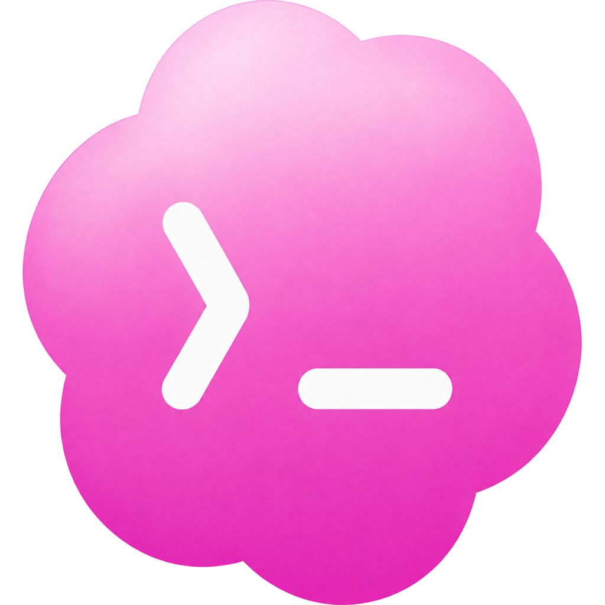
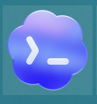
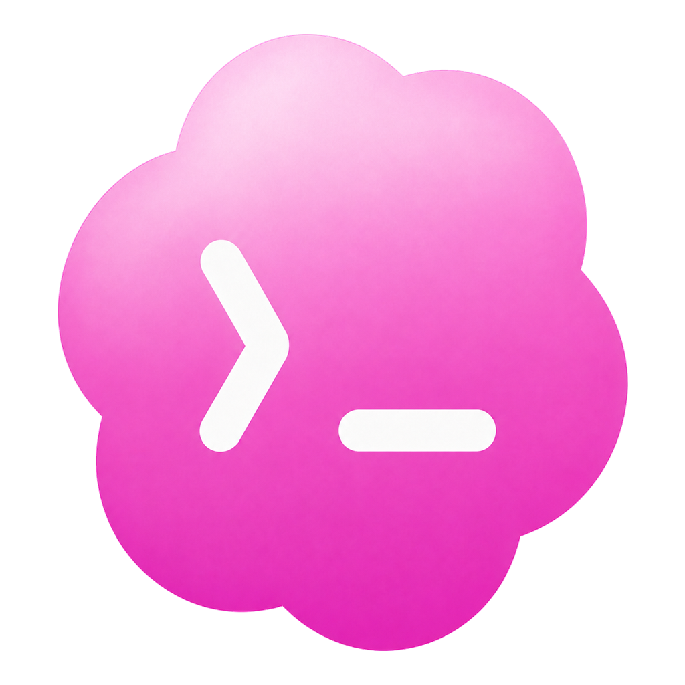
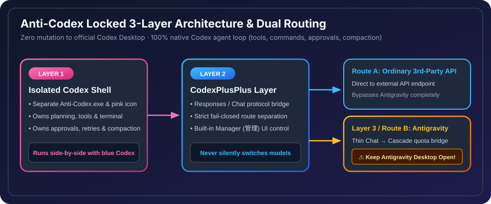
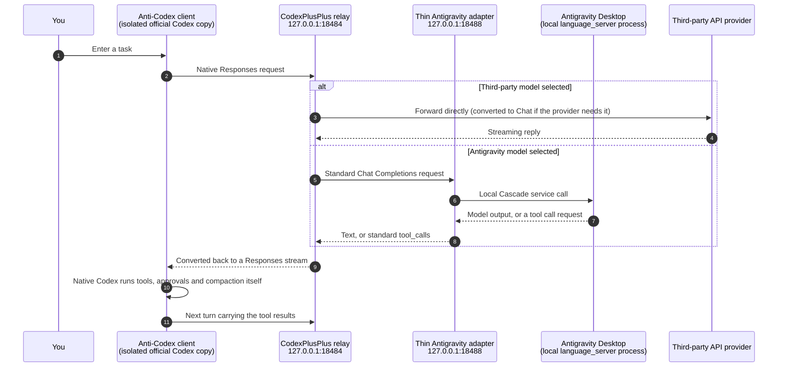
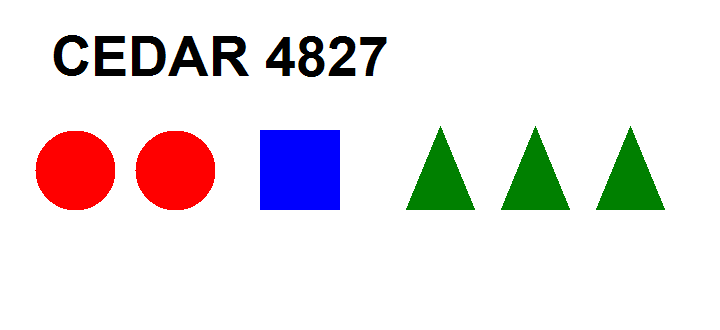

# Anti-Codex

<div align="center">



### Guarded, Isolated Official Codex Desktop Copy for Windows

[](#4-requirements--prerequisites)
[](#2-core-architecture-locked-3-layer-design)
[](#2-core-architecture-locked-3-layer-design)
[](#important-keep-antigravity-desktop-open-when-using-antigravity-models)
[](#license--disclaimer)

**[简体中文说明 (README.md)](README.md)** · **English Documentation** · **[3-Layer Architecture](docs/THREE_LAYER_ARCHITECTURE.md)** · **[Windows Guide](docs/WINDOWS.md)**

</div>

---

**Anti-Codex** is a guarded, `isolated` copy of the `official Codex` Desktop application for Windows. It preserves **100% of the native `Codex` UI, workflow, and underlying agent harness (`Codex` exclusively owns planning, `tools`, terminal commands, file edits, approvals, retries, and `compaction`)** while replacing only the model provider layer — letting you connect directly to third-party APIs or reuse your local **Antigravity Desktop** models and quota without touching a single file or login token of your original Codex installation.

> [!IMPORTANT]
> ### Important: Keep Antigravity Desktop Open When Using Antigravity Models!
> - **When using Antigravity models (MUST stay open)**: **Antigravity Desktop must be launched, signed in, and kept running in the background** (minimized is fine — do not quit it) the entire time you use Antigravity models in Anti-Codex. Anti-Codex bridges requests through your live local Antigravity Desktop `Cascade` service to fetch models and reuse your account quota; closing Antigravity will immediately stop model refresh and inference requests.
> - **When using ordinary third-party APIs (not required)**: Ordinary `third-party` traffic is routed directly by `CodexPlusPlus` to your configured provider endpoint and `bypasses` `Antigravity` completely. You do not need Antigravity open (or even installed) for standard API keys.

---

## 1. Visual Overview: Official Codex vs. Anti-Codex

<div align="center">
<table>
  <thead>
    <tr>
      <th align="center" width="240">Official Codex Desktop</th>
      <th align="center" width="240">Anti-Codex Isolated Copy</th>
      <th align="left">Side-by-Side Isolation Highlights</th>
    </tr>
  </thead>
  <tbody>
    <tr>
      <td align="center">
        <br/>
        <sub><b>Original Blue Icon</b> · <code>ChatGPT.exe</code></sub>
      </td>
      <td align="center">
        <br/>
        <sub><b>Distinct Pink Icon</b> · <code>Anti-Codex.exe</code></sub>
      </td>
      <td>
        <ul>
          <li><b>True Side-by-Side Coexistence</b>: Separate executable, pink taskbar/tray identity, and isolated Electron user-data paths.</li>
          <li><b>Zero Mutation to Original</b>: Never alters official WindowsApps files or <code>%USERPROFILE%\.codex</code> sessions/auth.</li>
          <li><b>100% Native Experience</b>: Keeps native diffs, terminal tool loop, approvals, compaction, and multimodal vision.</li>
        </ul>
      </td>
    </tr>
  </tbody>
</table>
</div>

### Why Anti-Codex?

| Goal | How Anti-Codex Solves It |
| :--- | :--- |
| **Protect your official Codex setup** | Copies the host into `%LOCALAPPDATA%\Anti-Codex` and stores all runtime state inside `%APPDATA%\anticodex`. |
| **Keep the real Codex agent harness** | No custom task loop; native `Codex` owns planning, `tools`, shell execution, approvals, retries, and `compaction`. |
| **Reuse local Antigravity Desktop quota** | Keep **Antigravity Desktop** open and pick Gemini / Claude models straight from the native Codex composer via a `thin` `Chat`-to-`Cascade` adapter. |
| **Connect any standard 3rd-party API** | Built-in `管理` (Manage) panel lets you test and switch to Responses or Chat Completions APIs directly. |
| **Safe updates & instant rollback** | Candidate host builds are patched, re-hashed, and gate-verified before atomic activation, keeping the prior version ready for 1-click rollback. |

---

## 2. Core Architecture (Locked 3-Layer Design)

<div align="center">
  
</div>

Anti-Codex is governed by a strict **[Three-Layer Architecture](docs/THREE_LAYER_ARCHITECTURE.md)** (see also **[Adaptive Provider Stack](docs/ADAPTIVE_ONE_API_STACK.md)**) and never introduces a fourth task-control layer:

1. **Layer 1 — Isolated Official Codex Shell**
   - Guarded copy of the installed official Codex Desktop app with minimal isolation patches (separate `Anti-Codex.exe`, AppUserModelId, pink icons, isolated state paths, and the in-app `管理` entry).
   - Native `Codex` owns planning, `tools`, command execution, approvals, retries, `compaction`, and completion decisions.
2. **Layer 2 — CodexPlusPlus General Provider Layer**
   - Upstream `CodexPlusPlus` (pinned release + audited isolation patches) handles general Responses/Chat conversion and ordinary third-party API connections.
   - **Direct Third-Party Bypass**: Ordinary `third-party` traffic connects directly to external providers and `bypasses` `Antigravity` completely.
3. **Layer 3 — Thin Antigravity Adapter**
   - Activated only when an Antigravity model is selected. This `thin` adapter maps standard `Chat` Completions requests to the running local Antigravity Desktop `Cascade` service, reusing its signed-in account, model catalog, and quota without taking over tools or task control.

> [!NOTE]
> **Security & Authorization Boundary**: Original Codex files and user data remain untouched. `Connector-backed app tools` remain unavailable until genuinely authorized; copied local metadata never fakes or grants authorization.

---

## 3. How It Works

In one sentence: **Anti-Codex makes the official Codex client believe it is talking to an ordinary OpenAI-style endpoint. That endpoint is actually a local relay, which forwards each request either to your third-party API or to your locally running Antigravity Desktop, depending on the model you picked.** Native Codex stays the brain (planning, tool calls, command execution). The relay only passes messages.

### The full path of one request



### What each step does

| Step | Details |
| :--- | :--- |
| **1. Build an isolated client** | The installer copies the official Codex app from WindowsApps into `%LOCALAPPDATA%\Anti-Codex\codex-patched-app` (the original stays read-only). It renames `ChatGPT.exe` to `Anti-Codex.exe`, swaps in the pink icons, applies a few minimal patches to `app.asar` (branding, the `管理` entry, etc.), and recomputes the ASAR integrity hashes so Electron loads it normally. |
| **2. Separate all data** | The copy launches with its own Codex home (`%APPDATA%\anticodex`) and its own Electron user-data directory, so sign-in state, chat history and config never mix with the original app. |
| **3. Point the model endpoint at the local relay** | The isolated client's model endpoint is `http://127.0.0.1:18484/v1`, served by `CodexPlusPlus`. The client still sends its native request format and notices no difference. |
| **4. Route by model** | `CodexPlusPlus` checks which model you picked. Third-party models go straight to the API you configured in `管理` (ordinary third-party traffic bypasses Antigravity). Antigravity models are converted to standard Chat Completions and handed to the thin adapter on port `18488`. Route mismatches fail closed instead of silently switching models. |
| **5. Thin adapter connects to Antigravity** | The adapter finds the running Antigravity Desktop `language_server` process, reads its local port and per-session CSRF token from the process command line, and calls Antigravity's local Cascade service with that token to list models, read account status, start a conversation, fetch replies and cancel requests. Usage counts against your own signed-in account. |
| **6. Tools stay with native Codex** | Codex's tools (shell commands, file edits, and so on) are offered to the Antigravity model through a temporary local MCP endpoint (random port plus random secret path). When the model wants a tool, the adapter turns that into standard `tool_calls` for Codex, and **Codex executes it under its own approval and permission rules**. The result is sent back to the model the same way. Antigravity never executes commands itself. |
| **7. Follow official updates** | After official Codex updates, sync rebuilds and validates a fresh copy in `update-candidate`, swaps it in only when every check passes, and keeps the previous version in `rollback-host`. |

### Why Antigravity Desktop must stay open

Step 5 talks to **the Antigravity Desktop process running on your machine**. Its port and token are generated when that process starts. Once Antigravity is closed, the process is gone, so the model list and chat requests both fail. Normal chats only use that process's local port and token, and Anti-Codex never talks to Antigravity's cloud directly. Only the optional account-switch feature in `管理` saves Antigravity sign-in snapshots locally, encrypted with Windows DPAPI for the current user. Ordinary third-party APIs use the direct branch in step 4 and do not need that process.

---

## 4. Requirements & Prerequisites

| Category | Requirement |
| :--- | :--- |
| **OS & Base Client** | Windows 10 / 11 (x64) with the official **Codex Desktop** installed (Microsoft Store / WindowsApps). |
| **Runtime** | **Node.js** (`node.exe` available on `PATH`) and Windows PowerShell 5.1. |
| **Route A: Ordinary 3rd-Party API** | Provider endpoint URL, model name, and API key (Antigravity does **not** need to be running or installed). |
| **Route B: Antigravity Models** | **Antigravity Desktop** installed, signed in, and **kept open/running while using Anti-Codex**, with working network access. |

---

## 5. Installation & Step-by-Step Usage

### Step 1: First-Time Installation

From the root of this repository, double-click:

```text
install-windows.bat
```

<details>
<summary>Or install from PowerShell (click to expand)</summary>

```powershell
powershell -ExecutionPolicy Bypass -File .\scripts\install-anticodex.ps1
```

The installer builds and validates the isolated host copy, deploys the verified `CodexPlusPlus` component, and creates the pink **Anti-Codex** Desktop shortcut and Start Menu folder.

</details>

### Step 2: Launch Anti-Codex (Check Prerequisites First!)

1. **If you plan to use Antigravity models**: **Launch Antigravity Desktop first and make sure it stays open and signed in** (leaving it in the background or minimized is fine).
2. Open **Anti-Codex** from your Desktop shortcut or `Start Menu > Anti-Codex > Anti-Codex`.
   - Launching the shortcut again while Anti-Codex is already open cleanly focuses the existing window instead of spawning duplicate instances.

### Step 3: Select Models, Vision Input & Third-Party APIs

- **Open Manager**: Click `管理` (Manage) in the bottom-left profile menu inside Anti-Codex, or open `Start Menu > Anti-Codex > Manage Anti-Codex`.
- **Use Antigravity Models**: Keep **Antigravity Desktop running**, refresh status/models in `管理`, and choose your desired model and reasoning effort directly from the native Codex composer menu.
- **Use Third-Party APIs**: In `管理`, click `配置第三方 API`, select Chat Completions or Responses, enter URL / model / API key, pass `测试连通` (Test Connection), and click `保存并切换` (Save & Switch). Click `恢复 Antigravity` anytime to switch back.
- **Fail-Closed Routing**: If the selected upstream is unreachable (for example, if Antigravity Desktop was closed), Anti-Codex fails closed with a clear error rather than silently switching to another model.

<div align="center">
  <br/>
  <sub>Built-in multimodal vision verification asset (<code>assets/vision-smoke.png</code>) — native image attachment and visual inspection work out of the box</sub>
</div>

### Step 4: Sync After Official Codex Updates

Whenever official Codex Desktop updates via Microsoft Store, run:

```text
Start Menu > Anti-Codex > Sync Anti-Codex with Codex
```

Sync stages a candidate build, applies all shell/icon patches and ASAR integrity hashes, and replaces the active host only if every validation gate passes.

### Step 5: One-Click Rollback

To revert to the previous validated host version at any time, run:

```text
Start Menu > Anti-Codex > Rollback Anti-Codex
```

---

## 6. Quick Troubleshooting (FAQ)

1. **Why did model refresh or chat fail when using an Antigravity model?**
   - Make sure **Antigravity Desktop is currently open and signed in** on your machine, then click refresh inside Anti-Codex `管理`.
2. **Can I run original blue Codex and pink Anti-Codex at the same time?**
   - Yes. Their binaries, local ports, Electron user-data directories, and state roots are completely isolated.
3. **Do I need Antigravity running when using my own third-party API key?**
   - No. Ordinary third-party APIs are routed directly by `CodexPlusPlus` and bypass Antigravity.

---

## 7. Developer Commands & Documentation Map

<details>
<summary><b>Diagnostic & Verification Commands (click to expand)</b></summary>

```powershell
# 1. Read-only check for official Codex updates and host drift
powershell -NoProfile -ExecutionPolicy Bypass -File .\scripts\check-anticodex-update.ps1 -NoPersist

# 2. Repair desktop/Start Menu shortcuts and isolated scheduled tasks
powershell -NoProfile -ExecutionPolicy Bypass -File .\scripts\repair-anticodex-shortcuts.ps1

# 3. Fast no-traffic installed health & UI verification (zero token cost)
powershell -NoProfile -ExecutionPolicy Bypass -File .\scripts\test-anticodex-installed-overall.ps1 -EnsureRunning -NoTraffic -Fast

# 4. Full source preflight & unit test suite (concurrency capped at 2)
powershell -NoProfile -ExecutionPolicy Bypass -File .\scripts\test-anticodex-source-preflight.ps1
node --test --test-concurrency=2 translator/tests/*.test.mjs
```

</details>

### Isolated Local Directories (Untouched `%USERPROFILE%\.codex`)

| Purpose | Path |
| :--- | :--- |
| **Install & Patched Host Root** | `%LOCALAPPDATA%\Anti-Codex` |
| **Isolated Config & State** | `%APPDATA%\anticodex` |
| **Health & Verification Reports** | `%APPDATA%\anticodex\reports` |

### Key Repository Documents

- **Chinese README**: [README.md](README.md)
- **Windows Setup & Runtime Guide**: [docs/WINDOWS.md](docs/WINDOWS.md)
- **Three-Layer Architecture**: [docs/THREE_LAYER_ARCHITECTURE.md](docs/THREE_LAYER_ARCHITECTURE.md)
- **Adaptive Provider Stack**: [docs/ADAPTIVE_ONE_API_STACK.md](docs/ADAPTIVE_ONE_API_STACK.md)
- **1.0 Completion Checklist**: [COMPLETION_CHECKLIST.md](COMPLETION_CHECKLIST.md)
- **Upstream Maintenance Guide**: [MAINTENANCE.md](MAINTENANCE.md)
- **Known Limitations**: [KNOWN_LIMITATIONS.md](KNOWN_LIMITATIONS.md)
- **Legacy Removal Manifest**: [docs/LEGACY_REMOVAL_MANIFEST.md](docs/LEGACY_REMOVAL_MANIFEST.md)
- **License & Third-Party Notices**: [LICENSE](LICENSE) · [THIRD_PARTY_NOTICES.md](THIRD_PARTY_NOTICES.md)

---

## License & Disclaimer

- **Project code**: [Non-commercial license](LICENSE). Personal, educational and research use, modification and sharing are allowed. Commercial use is not.
- **CodexPlusPlus component**: From upstream [BigPizzaV3/CodexPlusPlus](https://github.com/BigPizzaV3/CodexPlusPlus) under its AGPL-3.0 license. Patches live separately in `third_party/codexplusplus`.
- **Other third-party code**: See [THIRD_PARTY_NOTICES.md](THIRD_PARTY_NOTICES.md).
- This is a personal tool with no affiliation to OpenAI or Antigravity. The Antigravity connection uses the local desktop client's internal interface, which may change when Antigravity updates and temporarily break the route. Follow each service's terms of use.
