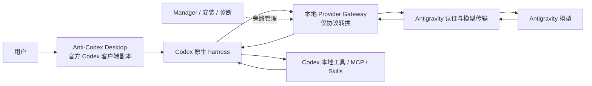

# Anti-Codex 产品架构基线

- 状态：项目基石，后续实现必须遵守
- 更新日期：2026-07-14
适用范围：单账号 Anti-Codex 产品、安装运行时、翻译器、Manager、测试与发布门禁

> **SUPERSEDING DECISION - 2026-07-14:** [`THREE_LAYER_ARCHITECTURE.md`](THREE_LAYER_ARCHITECTURE.md) is the highest-priority runtime architecture and [`FINAL_MIGRATION_PLAN.md`](FINAL_MIGRATION_PLAN.md) is the only current execution plan. The product is an isolated official Codex shell copy plus CodexPlusPlus with isolation-only changes. Ordinary third-party Responses/Chat APIs keep the native CodexPlusPlus route and never touch Antigravity; only Antigravity models use the thin Chat Completions-to-Cascade adapter. Any older statement below that keeps the self-written general Codex translator, requires a home-grown Responses adapter, routes every provider through Antigravity, treats CodexPlusPlus as development-only, or continues patching the mixed server is historical and must not guide new implementation.

> **ISOLATION REQUIREMENT:** “Official Codex shell” means a guarded Anti-Codex copy of the current official package. CodexPlusPlus must launch that copy with Anti-Codex-owned state. It must never launch, configure, patch or write state for the user's original Codex installation.

代码级现状、CC Switch 实际复用状态和逐文件处置清单见 [`CURRENT_IMPLEMENTATION_AUDIT.md`](CURRENT_IMPLEMENTATION_AUDIT.md)。本文件定义目标，审计文件定义当前代码事实；两者都必须读取。

## 1. 最终目标

Anti-Codex 是一份独立运行、独立数据、独立品牌的 Codex Desktop。用户使用它时，任务执行、工具调用、多轮续跑、权限、取消、压缩恢复和中途对话都由 Codex 原生 harness 负责；Antigravity 只提供模型能力。

最终体验不是“像 Codex 的另一个 Agent”，而是“Codex 本身换成 Antigravity 模型入口”。

## 2. 不可修改的架构基石

1. Codex 原生客户端是唯一任务控制器。
2. 本地适配层只做认证、模型发现和协议的结构化转换。
3. 适配层不得根据用户任务自行选择工具、生成命令、修补代码、安排重试、强制测试、判断业务完成或接管续跑。
4. Codex 请求里有什么工具，适配层就原样映射什么工具；适配层不得注入一套替代 Codex 的工具。
5. 只有明确、结构化的上游工具调用才能转换成 Codex 工具事件。普通文字中的“我要执行”“已经执行”不能被猜成工具调用。
6. 工具在 Codex 本地执行，工具结果由 Codex 放进下一次模型请求；适配层只保持 `call_id`、顺序、状态和历史一致。
7. 原生 Codex 安装、账号和数据不得被 Anti-Codex 改写。
8. Anti-Codex 的图标、任务栏图标、托盘图标、中文名称和独立数据目录必须保留。
9. 发布成功只能由文件、命令、测试、进程和协议事件证明，不能由模型回复文字或完成标记单独证明。
10. 任何违反以上条款的改动都属于架构回归，不能用“兼容修复”名义合入。

## 3. 最终数据流

一次正常工具循环必须是：

1. Codex 把当前上下文和自身工具定义发送给本地 Provider Gateway。
2. Gateway 只把请求结构转换成 Antigravity 能接受的结构。
3. 模型返回明确的结构化工具调用。
4. Gateway 把它一对一转换为 Codex Responses 工具事件。
5. Codex 原生 harness 执行本地工具。
6. Codex 把工具结果加入下一轮请求。
7. 模型继续推理，直到它返回正常完成；Gateway 不替它续跑或收尾。

## 4. CC Switch 评估与采用决策

评估基线：官方仓库 `farion1231/cc-switch` 的 2026-07 主线和 v3.16.x。该项目使用 MIT 许可证，是 Tauri 桌面管理器，已经包含 Codex Provider 管理、本地代理、协议转换、工具历史映射、流式 Responses 事件、故障切换和配置切换。

官方来源：

- https://github.com/farion1231/cc-switch
- https://github.com/farion1231/cc-switch/tree/main/src-tauri/src/proxy/providers
- https://github.com/farion1231/cc-switch/releases

### 4.1 CC Switch 已满足的部分

| 需求 | CC Switch | 结论 |
|---|---:|---|
| 让现有 Codex 使用第三方 Provider | 满足 | 它管理 Codex 配置并可本地接管路由 |
| Codex Responses 与 Chat/其他协议转换 | 大部分满足 | 已有独立 Codex 转换和流式事件模块 |
| 工具调用、工具结果和多轮历史结构映射 | 满足并持续维护 | 这是应优先复用和对照的部分 |
| Provider 切换、健康检查、故障切换 | 满足 | 可作为实现参考，不是当前核心缺口 |
| MCP、Skills 和配置管理 | 满足 | Anti-Codex 已有独立状态同步，不需要重做一套 CC Switch UI |

### 4.2 CC Switch 不能直接满足的部分

| Anti-Codex 特有需求 | CC Switch 原版状态 | 处理方式 |
|---|---|---|
| 使用本机已登录的 Antigravity 权益，而不是普通 API key | 未发现原生支持 | 保留 Anti-Codex 的 Antigravity 认证、账号和模型桥接 |
| 一份独立品牌的 Codex Desktop 副本 | 不提供 | 保留现有 client-copy、独立启动器和隔离状态 |
| Anti-Codex 图标、托盘图标、中文 Manager | 不提供 | 保留现有品牌和 UI 补丁 |
| 与原版 Codex 并行运行且不污染原版状态 | 不是它的产品目标 | 保留现有隔离目录、进程和同步机制 |
| Codex 更新后自动同步客户端壳并保留 Anti-Codex 定制 | 不提供 | 保留现有候选同步、回滚和指纹验证 |

### 4.3 最终采用方式

不把 CC Switch 整个项目作为 Anti-Codex 的产品壳，也不从零再写一套代理。

采用以下组合：

1. 保留现有 Anti-Codex Codex 客户端副本、Antigravity 登录桥、品牌、隔离、安装和 Manager。
2. 以 CC Switch 的 Codex Provider 代理模块为优先协议参考和可复用来源，重点核对：
   - `codex.rs`
   - `codex_chat_common.rs`
   - `codex_chat_history.rs`
   - `codex_responses_sse.rs`
   - `streaming_codex_chat.rs`
   - `transform_codex_chat.rs`
   - `transform_responses.rs`
3. 优先移植其经过真实用户验证的结构转换、流式事件和工具历史规则，保留 MIT 许可证与第三方声明。
4. 不移植 CC Switch 的整套桌面 UI、Provider 商店、云同步和多应用管理；这些与 Anti-Codex 目标无关。
5. 如果完整移植成本过高，至少逐项移植其协议测试夹具和事件契约，当前 Node Gateway 必须通过同等约束后才能保留。

结论：如果需求只是“给原版 Codex 换一个标准 API Provider”，CC Switch 原版足够；当前需求还包括 Antigravity 权益接入、独立 Anti-Codex 客户端和品牌隔离，因此 CC Switch 不能直接替代整个项目，但它应替代我们自行发明的 Codex 协议转换思路。

当前真实采用状态：截至 2026-07-13，已完成源码研究和架构对照，并把 `transform_codex_chat.rs` 的请求/响应规则与 `codex_responses_sse.rs` 的事件信封等价移植到 Node 协议层，同时新增 `THIRD_PARTY_NOTICES.md`。当前有 13 个 CC Switch 等价测试组，连同本地边界测试共 23 项通过；已覆盖无工具字段清理、custom 元数据、namespace、tool_search、文件/图片/音频、推理拆分、坏响应、Provider 错误以及 SSE 成功/失败事件顺序。历史恢复和真正增量流式仍未移植，当前通过不能误报为完整 CC Switch 等价实现。

## 5. 最终技术方案

### 5.1 客户端层：保留

- 来源是当前官方 Codex Desktop 客户端副本。
- Codex 更新通过候选目录同步，校验后激活，失败保留旧版。
- 只补品牌、独立状态、启动器、中文 Manager 和必要兼容入口。
- 不修改 Codex 任务循环、工具执行器、会话管理和权限逻辑。

### 5.2 Provider 配置层：保留并收紧

- Anti-Codex 的 Codex 配置只指向本地回环 Provider；地址由运行时解析器确定，当前安装实例为 `http://127.0.0.1:8484`，不得在验证脚本中硬编码旧端口。
- 使用 Codex 原生 Responses wire protocol。
- 原版 Codex 配置与登录态不变。
- 第三方 Provider 是可选能力，不参与默认 Antigravity 主链路。

### 5.3 Codex 协议层：重点改造

该层必须从当前大文件中拆成可单测的纯转换模块：

- 请求映射：Codex Responses 输入、指令、工具、历史到上游结构。
- 工具映射：function/custom/namespace 工具名称、参数和 `call_id` 一对一映射。
- 流事件映射：created、output item、argument delta、text delta、completed、failed。
- 历史映射：工具调用与工具结果成对、顺序稳定、跨轮不丢失。
- 错误映射：认证、额度、网络、协议错误转换为明确失败，不伪造成功。

允许的兼容行为：

- 解析上游明确输出的结构化 `tool_calls`、Gemini function call 或明确 DSML 工具块。
- 规范化字段名、事件顺序和流式分片。
- 对协议缺字段给出确定错误。

禁止的兼容行为：

- 从自然语言推测要调用什么工具。
- 根据用户任务生成 PowerShell、Shell、补丁或测试命令。
- 自动补写文件、修复补丁、强制验证、阻止或替换 Codex 工具调用。
- 根据文件名、任务类型或回复文字判断业务是否完成。
- 在失败后替 Codex 发起新的任务轮次或修改用户意图。
- 为了让测试通过而直接返回固定标记。

### 5.4 Antigravity 传输层：保留并标准化

- 负责复用本机 Antigravity 登录权益。
- 负责账号状态、模型目录、模型档位和真实请求传输。
- 向协议层提供统一的文本、结构化工具调用、用量和结束原因。
- 不知道用户工作目录，不生成本地命令，不读写用户项目。
- 正式主链路必须使用能分别承载 system/developer/user/tool 角色和结构化工具定义的上游接口。不得把完整 Codex 请求、工具 JSON 和角色标签拼成一条普通 Antigravity 用户 Prompt；实测 Antigravity 会把这种格式判为提示注入，并优先服从自身 Agent 工具集。
- 优先方案是复用 Antigravity 登录权益的原始结构化模型接口；若只能使用 Desktop Cascade，则必须通过已验证的结构化定制/MCP 事件承载工具调用，并确保 Codex 执行工具且不会出现 Antigravity 权限弹窗。单文本 Prompt/DSML 只能保留为诊断对照，不能作为产品默认路径。

### 5.5 Manager 与运维层：保留

- 保留 Anti-Codex 图标、托盘图标、任务栏名称和 `管理` 入口。
- 保留账号、模型、同步、诊断、报告和第三方 Provider 管理。
- Manager 不参与当前任务的模型决策和工具循环。
- 历史清理必须备份优先，不影响原版 Codex。

## 6. 当前代码处置清单

### 6.1 保留

| 模块 | 当前价值 | 处置 |
|---|---|---|
| `deepcodex.app/`、`assets/` | 独立客户端、品牌和图标 | 保留 |
| 启动器、安装、候选同步和回滚脚本 | 独立安装与跟随 Codex 更新；当前已同步 `26.707.8479.0`，CLI 为 `0.144.2` | 保留，后续版本继续回归 |
| 独立 `%APPDATA%\anticodex` 状态 | 不污染原版 Codex | 保留 |
| Antigravity 账号、模型发现和健康检查 | 已能看到账号和 8 个模型 | 保留 |
| Antigravity 上游真实文本传输 | 文本请求可真实到达模型 | 保留 |
| Manager、中文入口、图标和关闭按钮实现 | 产品管理面；当前新版实机验收通过 | 保留，每次 Codex 更新重跑 |
| 诊断、运行时指纹和安装完整性 | 能发现源码与运行时偏差 | 保留 |
| 真实任务脚本中的宿主结果校验 | 不相信模型回复文字 | 保留并升级为主门禁 |

### 6.2 改造

| 模块 | 当前问题 | 目标 |
|---|---|---|
| `translator/adaptive-server.mjs` | 单文件约 1 MB，协议、Manager 和任务控制混杂 | 拆出纯协议主链路，Manager/报告旁路化 |
| Codex Responses 工具转换 | 简单任务也会把执行意图当文字，或生成错误工具调用 | 对照/复用 CC Switch 的结构转换和 SSE 规则 |
| 上游 Prompt | 混入大量任务行为、补丁和验证指令 | 只保留协议格式说明和模型必要上下文 |
| 会话恢复 | `previous_response_id` 已能复用原 Cascade；原生会话丢失时，普通 user/assistant/tool/call/result 历史会以有界、按序、明确不可信的 JSONL 续入新 Cascade。CC Switch 的并行工具组、唯一匹配和歧义拒绝仍不完整 | 只维护结构化响应与 Cascade 的协议映射；任务恢复和继续执行仍交给 Codex |
| 发布门禁 | 旧门禁可在真实用户任务失败时仍报全绿 | 以原生链路真实文件和命令结果为主门禁 |
| 长任务测试 | 旧门禁曾在工具调用之间的短暂空闲提前收卷，并错误要求正常命令携带最终 marker | 按当前任务的真实工具调用/结果、新最终回复、宿主结果和连续稳定空闲判定；继续完成真人式长任务矩阵 |

### 6.3 删除或默认禁用

- Translator 内部工具注入。
- 从用户提示或模型自然语言生成工具调用的逻辑。
- 自动生成创建文件、启动程序、测试和补丁命令的逻辑。
- Patch 格式修复、自动改写 Patch、重复写入拦截和强制 post-patch 验证。
- Translator 代发修复轮次、完成哨兵、exact-marker 直返和业务完成判断。
- 针对某个测试目录、文件名、任务类型硬编码的行为。
- 只靠模型回复、UI 文本或 marker 判定成功的发布规则。
- `buildAntigravityProtocolPrompt` 及当前单文本 Prompt/DSML 生产桥；它可以留作离线诊断对照，但不能承载正式请求。

迁移期间可以短暂保留旧代码用于对照，但必须默认关闭、不能位于正式请求路径，并设置删除期限。

### 6.4 尚未完成

结构化 Antigravity normal 主路径已经完成并同步到安装运行时：system/developer 指令使用可信 Custom Agent sections，Codex 工具 schema 使用 native MCP，工具结果续回同一 Cascade；结构失败会直接失败，不再回落到单文本 Prompt/DSML。网关级原生工具闭环和一次 Codex Desktop 本地三文件任务均已通过真实流量与宿主结果验证。

剩余项：

1. 纯 Codex 原生工具调用主链路的剩余迁移：真正增量内容流、WebSocket 总验收，以及 CC Switch 的并行工具组、唯一 `call_id` 匹配和歧义拒绝。普通续轮复用原 Cascade、会话丢失后的有界完整普通历史续接、64 条容量/淘汰/TTL 和 native compact 已完成。
2. 同一频道中的多轮基础、六回合库存项目和用户中途纠正已完成；仍须覆盖独立的中断迁移长任务、客户端重启后恢复和新的十文件以上项目，不能用一种库存任务代替多种项目形态。
3. 用户取消、总超时和上下文压缩已经接入原生 harness 并通过真实流量；仍缺客户端崩溃/重启后的恢复验证。
4. 精确结果和边缘验收：不得用 `Trim()` 掩盖换行/BOM/字节数错误，失败后必须修正并重新按原始结果验证。
5. 不重复启动程序、不循环执行同一命令、失败后先诊断再继续。真实矩阵已证明“已运行时 0 次启动”和“首启失败时总共 1 次启动”，后续改动必须保留该门禁。
6. 大量历史频道下的加载性能、备份与安全清理。
7. 新架构下的 UI、中文、关闭按钮全区域点击和图标最终回归。
8. 删除或隔离旧生产语义补偿，并建立不依赖语义补偿的新发布门禁。

2026-07-14 最新结果：结构化主路已通过一个 7 回合库存项目（6 个正常用户轮次、1 个会话重置恢复轮）。宿主验证 10 个文件、保护文件哈希、测试、dry-run、普通运行、隐藏规则、中文报告和六项业务指标；恢复轮只执行 3 条当前项目命令，越界数为 0。三类真人边缘矩阵也新鲜 3/3 通过：需求纠正保留旧功能并追加新功能，已运行程序启动 0 次，首启失败场景总启动 1 次。该证据仍未覆盖客户端重启、独立中断迁移长任务、真正增量正文和完整 WebSocket，因此总进度保持 84%。

### 6.5 冷 Cascade 历史契约

- 仅在原生 Response/Cascade 无法恢复时注入历史；正常 resume 不重复发送历史。
- 最新用户消息继续作为原生 `userText`，不能被拼进 system prompt；其余普通 user/assistant/tool 事件按原顺序编码为 JSON Lines。
- assistant 工具调用保留 `call_id`、名称和参数；tool result 保留对应编号、名称、输出和已完成状态。所有记录都明确标记为不可信 transcript 数据，不能覆盖 system/developer/workspace/最新用户指令。
- 历史长度受现有 prompt/tool-output 上限控制，超限时保留开头和最近尾部并写入结构化截断记录；每一行截断后仍必须是合法 JSON。
- 真人长任务门禁同时检查命令范围。访问 `.gemini/antigravity/brain`、Anti-Codex 私有报告/历史、宿主源码目录或项目目录外绝对路径都直接判红，不能再以最终文件正确掩盖过程失控。

## 7. 当前完成度

完成度按用户可获得的最终体验加权，不按代码行数、脚本数量或旧报告数量计算。

| 工作面 | 权重 | 当前得分 | 当前判断 |
|---|---:|---:|---|
| Codex 客户端副本、隔离、品牌、更新同步 | 20 | 19 | 官方/活动 `26.707.8479.0`、CLI 指纹、品牌图标和新版 UI 已回归；仍需最终冷启动/安装总验收 |
| Antigravity 账号、模型、真实文本传输 | 20 | 18 | 大体完成，模型能力已接通 |
| 严格 Responses、流式、工具和历史协议 | 25 | 19 | normal、native compact、同 Cascade 续跑和冷 Cascade 普通历史续接已通过；并行工具/歧义恢复、WebSocket 总验收与真正增量正文仍缺失 |
| 真实任务、多轮续跑和边缘情况 | 20 | 19 | 两轮项目、精确字节、取消、压缩恢复、7 回合库存、三轮中断迁移及纠正/启动边缘已通过；客户端重启和新十文件以上项目仍未通过 |
| Manager、中文、历史性能和日常体验 | 10 | 8 | 中文/关闭按钮/备份清理/自动恢复已实机通过；仍需大量频道压力基准和最终总回归 |
| 安装、诊断、恢复和可信发布门禁 | 5 | 4 | 基础完整，但旧门禁高估产品完成度 |
| **总计** | **100** | **87** | **当前产品完成度 87%** |

说明：基础设施本身约 90%。阶段 B 已完成；阶段 C 已完成取消、超时、会话容量/淘汰、优雅关闭、native compact、冷会话普通历史续接、7 回合库存项目、三轮中断迁移和三类启动/纠正边缘矩阵。当前为 87%，因为客户端重启恢复、新十文件以上项目、并行工具历史、WebSocket、增量内容流和最终产品回归仍未完成。早先的 `goalComplete:true` 和旧全绿结论仍不作为最终完成证据。

## 8. 剩余路线与进度增量

| 阶段 | 交付 | 预计完成后总进度 |
|---|---|---:|
| A. 结构化上游与架构门禁 | 角色/工具 schema/调用/结果结构化传输，normal 路由不再落回语义补偿 | 68%（已完成） |
| B. 原生简单工具闭环 | 读/写/执行/结果回传/正常收尾及全新两轮项目，零语义补偿 | 81%（已完成） |
| C. 长任务和真人边缘情况 | 多轮项目、纠正、失败、取消、恢复、只启动一次 | 当前 87%，全部完成后 95% |
| D. 产品收尾 | UI/图标/中文/关闭按钮/历史性能/安装/发布门禁 | 100% |

阶段不能跳过。B 已完成；C 的取消/超时/会话生命周期、compact、冷历史恢复、六回合项目、三轮中断迁移、中途纠正、失败诊断和只启动一次已通过，当前计 87%。C 还要通过客户端重启和新十文件以上项目，并闭环增量/WebSocket 协议；C 未通过前，不宣称可用于真实项目。D 未通过前，不宣称项目结束。

## 9. 结果验收标准

### 9.1 协议级

- 同一 `call_id` 的调用和结果严格成对。
- 流事件顺序符合 Codex Responses 预期。
- 工具参数增量可重组为唯一合法参数。
- 失败返回失败，不返回伪完成。
- 不存在 Translator 自己生成的业务命令或文件内容。

### 9.2 简单真实任务

- 用户要求创建或修改一个文件，磁盘内容必须符合要求。
- Codex 工具历史必须显示真实调用和真实结果。
- 宿主重新运行命令或测试必须通过。
- 不允许用模型说“已完成”作为证据。

### 9.3 长任务

至少通过以下三类真实 Antigravity 流量任务：

1. 现有仓库改 Bug：不少于 6 个用户轮次，包含中途纠正、追问、继续修改和回归测试。
2. 新建多文件项目：不少于 10 个有效文件，包含依赖、实现、测试、运行、失败修复和最终验收。
3. Windows 桌面任务：包含启动程序、已经运行时不再启动、首次失败后诊断、生成 BAT 和实机验证。

每类任务都检查：

- 实际文件集合和内容哈希。
- 宿主独立执行的测试与命令输出。
- 进程启动次数和重复命令次数。
- 是否产生未请求文件、缓存或越界修改。
- 同一频道上下文是否连续。
- 用户中途消息是否被及时响应并继续原任务。
- 取消、超时、失败和重启后是否可恢复。
- 验证器超时或用户取消后，活跃请求、队列和会话锁归零，并在观察窗口内不再产生新工具调用。
- 同一任务的后续消息复用可证明的稳定会话标识，不得为了找回上下文遍历项目或 Antigravity 私有运行目录。
- 每个用户回合都必须有该回合新增的最终回复；工具调用之间的瞬时空闲不能算完成。
- 正常工具命令不需要包含测试 marker；工具证据按当前任务边界和 `call_id` 关联，marker 只用于精确产物验收。

### 9.4 UI 和产品级

- UI 与当前 Codex 主要功能和布局一致。
- `管理` 保持中文，不能显示 `Manager`。
- Manager 关闭按钮上、中、下区域都通过真实鼠标按下/释放。
- 应用、任务栏、托盘和右下角图标保持 Anti-Codex 图标。
- 大量历史频道下仍可打开频道；清理前有可恢复备份。
- Anti-Codex 与原版 Codex 可同时运行，状态互不污染。

## 10. 架构门禁

后续必须新增并保持以下自动门禁：

1. 正式主链路不得调用内部工具注入、命令合成、Patch 修复、强制验证和业务完成判断。
2. Translator 的纯协议模块不得读取工作目录文件或启动本地进程。
3. 协议夹具覆盖 function、custom、namespace、并行调用、失败、取消和跨轮历史。
4. 真实任务门禁必须记录文件、命令、测试和进程证据。
5. Release gate 不能因为 response marker 存在就覆盖任务结果失败。
6. 每次 Codex 或 CC Switch 相关协议更新都先跑兼容差异测试，再同步正式运行时。
7. 桌面同任务测试必须精确选中目标任务；验证器超时必须主动取消对应请求，不能只停止观察脚本。
8. 标题生成等后台辅助请求必须清空工具和 `previous_response_id`，不得接管、恢复或保留主任务 Cascade。
9. Antigravity 的 `/responses/compact` 必须使用原生结构化 handler，清空工具、禁止会话继承并只把 `context_compaction` 摘要写入恢复历史；不得调用旧 `callQueuedAntigravityUpstream`。

## 11. 后续改动纪律

每个实现任务开始前必须回答：

1. 它属于本文哪一层？
2. 是否让 Codex 原生 harness 继续拥有任务控制权？
3. 是否只做结构转换，而没有猜测业务意图？
4. 用什么外部结果证明完成？
5. 完成后本文中的哪一项进度发生变化？

如果回答不清楚，不能开始写代码。修改本文件中的架构基石，必须先与用户讨论并获得明确同意。

迁移必须“先替换、再切流、后删除”：先在小模块中接通结构化上游和契约测试，再让 normal、compact、WebSocket 依次切换并 fail-closed；真实桌面闭环通过后，才删除不可达的旧语义代码和错误测试。不得为了清理而先拆掉仍被当前运行时依赖的认证、模型发现、取消、队列、同 Cascade continuation 或回滚能力。

## 12. 2026-07-14 Compact 原生通路检查点

- 真实失败首先证明旧路由有架构错误：`/v1/responses/compact` 被排除在原生 handler 之外，落到旧 Cascade 调用并返回 `unknown_tool run_command`。
- 现在 compact 与普通 Antigravity 请求共用原生结构化生命周期；专用纯转换模块把已 hydration 的 Responses 输入作为数据交给模型摘要，工具、工具选择、前序 Response 会话和结果会话保留全部关闭，意外工具调用失败关闭。
- `context_compaction` 在原生协议中恢复为结构化上下文；compact 的 Response history 只保存摘要，不再把压缩前的整段历史重新 hydration。
- 安装态真实报告 `latest-compaction-resume.json` 为 `ok:true`。随机标记 `COMPACT_SEED_27899_20260714` 和下一步同时保留；直接回灌摘要与 `previous_response_id` 链式续跑均返回正确事实，无工具调用。
- 验证器早期异常现在也写新鲜红色报告；用不可达本地端口实测得到退出码 1、`ok:false`、`behaviorCovered:false`、`terminalError` 和一个失败项。完成度仍为 84%，因为两类剩余长任务、客户端重启、增量流、完整历史、WebSocket 与最终产品回归尚未完成。

## 13. 2026-07-14 桌面更新、原生 Patch 与历史维护契约

- 官方 Codex 与活动 Anti-Codex 壳已对齐到 `26.707.8479.0`，host/CLI 指纹一致，Anti-Codex 应用、任务栏、托盘和快捷方式图标保持不变。更新验收等待上限与回滚补丁清单按新版启动时序修正，不能把“启动较慢”误判成候选损坏。
- 原生 `apply_patch` 适配只允许做协议语法转换：把标准 unified hunk 头转换为 Codex custom-tool 格式，并将相对文件路径锚定到 Codex 明确传入的工作目录；越出工作目录的 `..` 路径拒绝转换。它不得理解任务、改写补丁内容或替模型生成修复。
- Desktop 自动化在真实发送前必须用真实 Escape 键关闭模型菜单或对话遮罩，确认遮罩消失后重新定位发送控件，再用 CDP 鼠标按下/释放。遮罩未消失就失败，不得 DOM 强点或伪造已提交。
- 历史清理继续遵守“先备份、只处理 Anti-Codex、原版 Codex 不动、项目入口保留”。若清理前 Anti-Codex 正在运行，清理完成后必须通过安装态启动器恢复运行并明确报告重启结果；预演和 `-SkipRestart` 不产生启动副作用。
- 2026-07-14 实机清理后独立会话库存为 0 个文件、0 字节，侧栏为“无任务”；最新备份为 `cleanup-20260714-062455`。`native-panel-v104` 的关闭按钮上/中/下命中与真实鼠标关闭均通过。中断迁移重跑结果见下一节。

## 14. 2026-07-14 三轮中断迁移真实通过

- 修复后的 Sonnet 4.6 真实 Desktop 旅程在 250,140 ms 内 3/3 回合通过；三个回合都有工具前中文进度、真实工具输出、本回合新增最终回复和零命令越界。
- 宿主独立验证迁移实现与测试、两次普通运行、规范化输出、摘要、拒绝文件原始字节、幂等结果、保护文件哈希和临时文件清理全部通过；实际文件集合严格为 8 个，无额外文件。
- 第一轮的原生 `apply_patch` 已直接证明工作目录锚定和 hunk 转换有效；第二、三轮都成功提交，直接证明 `.codex-dialog-overlay` 不再挡住真实鼠标发送。第三轮识别并删除残留 `.normalized.json.tmp`，随后两次运行及测试均通过。
- 报告为 `%APPDATA%\anticodex\reports\latest-ui-human-long-journey.json`，`failures:[]`、`scopeViolationCount:0`、`rejectsExact:true`、`staleTempAbsent:true`。这关闭一个独立长任务形态，与 8479/UI/历史维护证据合计将当前完成度从 84% 提高到 87%；仍不代表新十文件项目、客户端重启、增量/WebSocket 和并行历史已完成。

## 15. 2026-07-14 CodexPlusPlus 采用决策

- 已按 `BigPizzaV3/CodexPlusPlus` v1.2.36 / `91a83acd8bdf79a388a106c7c1ea76f9df6bcea9` 做源码级对照，完整结论见 [`audits/2026-07-14-codexplusplus-reference-audit.md`](audits/2026-07-14-codexplusplus-reference-audit.md)。
- 它再次证明本文件的基石正确：Codex harness 掌管任务，本地层只做 Provider 与协议转换。Anti-Codex 不改成另一套任务控制器，也不从零重写客户端。
- CodexPlusPlus 为 AGPL，本项目当前许可证不同，因此只采用行为契约和测试矩阵；可直接复用的协议代码继续优先取自已审计的 MIT CC Switch 来源。
- 不整体换底座：CodexPlusPlus 的标准 API 代理不能自动解决 Antigravity Desktop 的有状态 Cascade/MCP 结果回填。现有独立品牌、数据、图标、官方 host 同步和 Manager 保留，集中补齐 Antigravity 到 Responses 的最后协议边缘。
