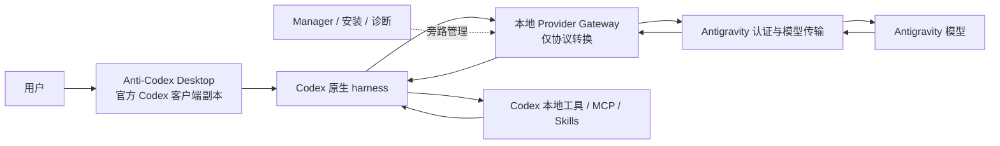

# Anti-Codex 产品架构基线

- 状态：项目基石，后续实现必须遵守
- 更新日期：2026-07-13
适用范围：单账号 Anti-Codex 产品、安装运行时、翻译器、Manager、测试与发布门禁

代码级现状、CC Switch 实际复用状态和逐文件处置清单见 [`CURRENT_IMPLEMENTATION_AUDIT.md`](CURRENT_IMPLEMENTATION_AUDIT.md)。本文件定义目标，审计文件定义当前代码事实；两者都必须读取。

## 1. 最终目标

Anti-Codex 是一份独立运行、独立数据、独立品牌的 Codex Desktop。用户使用它时，任务执行、工具调用、多轮续跑、权限、取消、压缩恢复和中途对话都由 Codex 原生 harness 负责；Antigravity 只提供模型能力。

最终体验不是“像 Codex 的另一个 Agent”，而是“Codex 本身换成 Antigravity 模型入口”。

## 2. 不可修改的架构基石

1. Codex 原生客户端是唯一任务控制器。
2. 本地适配层只做认证、模型发现和协议的结构化转换。
3. 适配层不得根据用户任务自行选择工具、生成命令、修补代码、安排重试、强制测试、判断业务完成或接管续跑。
4. Codex 请求里有什么工具，适配层就原样映射什么工具；适配层不得注入一套替代 Codex 的工具。
5. 只有明确、结构化的上游工具调用才能转换成 Codex 工具事件。普通文字中的“我要执行”“已经执行”不能被猜成工具调用。
6. 工具在 Codex 本地执行，工具结果由 Codex 放进下一次模型请求；适配层只保持 `call_id`、顺序、状态和历史一致。
7. 原生 Codex 安装、账号和数据不得被 Anti-Codex 改写。
8. Anti-Codex 的图标、任务栏图标、托盘图标、中文名称和独立数据目录必须保留。
9. 发布成功只能由文件、命令、测试、进程和协议事件证明，不能由模型回复文字或完成标记单独证明。
10. 任何违反以上条款的改动都属于架构回归，不能用“兼容修复”名义合入。

## 3. 最终数据流

一次正常工具循环必须是：

1. Codex 把当前上下文和自身工具定义发送给本地 Provider Gateway。
2. Gateway 只把请求结构转换成 Antigravity 能接受的结构。
3. 模型返回明确的结构化工具调用。
4. Gateway 把它一对一转换为 Codex Responses 工具事件。
5. Codex 原生 harness 执行本地工具。
6. Codex 把工具结果加入下一轮请求。
7. 模型继续推理，直到它返回正常完成；Gateway 不替它续跑或收尾。

## 4. CC Switch 评估与采用决策

评估基线：官方仓库 `farion1231/cc-switch` 的 2026-07 主线和 v3.16.x。该项目使用 MIT 许可证，是 Tauri 桌面管理器，已经包含 Codex Provider 管理、本地代理、协议转换、工具历史映射、流式 Responses 事件、故障切换和配置切换。

官方来源：

- https://github.com/farion1231/cc-switch
- https://github.com/farion1231/cc-switch/tree/main/src-tauri/src/proxy/providers
- https://github.com/farion1231/cc-switch/releases

### 4.1 CC Switch 已满足的部分

| 需求 | CC Switch | 结论 |
|---|---:|---|
| 让现有 Codex 使用第三方 Provider | 满足 | 它管理 Codex 配置并可本地接管路由 |
| Codex Responses 与 Chat/其他协议转换 | 大部分满足 | 已有独立 Codex 转换和流式事件模块 |
| 工具调用、工具结果和多轮历史结构映射 | 满足并持续维护 | 这是应优先复用和对照的部分 |
| Provider 切换、健康检查、故障切换 | 满足 | 可作为实现参考，不是当前核心缺口 |
| MCP、Skills 和配置管理 | 满足 | Anti-Codex 已有独立状态同步，不需要重做一套 CC Switch UI |

### 4.2 CC Switch 不能直接满足的部分

| Anti-Codex 特有需求 | CC Switch 原版状态 | 处理方式 |
|---|---|---|
| 使用本机已登录的 Antigravity 权益，而不是普通 API key | 未发现原生支持 | 保留 Anti-Codex 的 Antigravity 认证、账号和模型桥接 |
| 一份独立品牌的 Codex Desktop 副本 | 不提供 | 保留现有 client-copy、独立启动器和隔离状态 |
| Anti-Codex 图标、托盘图标、中文 Manager | 不提供 | 保留现有品牌和 UI 补丁 |
| 与原版 Codex 并行运行且不污染原版状态 | 不是它的产品目标 | 保留现有隔离目录、进程和同步机制 |
| Codex 更新后自动同步客户端壳并保留 Anti-Codex 定制 | 不提供 | 保留现有候选同步、回滚和指纹验证 |

### 4.3 最终采用方式

不把 CC Switch 整个项目作为 Anti-Codex 的产品壳，也不从零再写一套代理。

采用以下组合：

1. 保留现有 Anti-Codex Codex 客户端副本、Antigravity 登录桥、品牌、隔离、安装和 Manager。
2. 以 CC Switch 的 Codex Provider 代理模块为优先协议参考和可复用来源，重点核对：
   - `codex.rs`
   - `codex_chat_common.rs`
   - `codex_chat_history.rs`
   - `codex_responses_sse.rs`
   - `streaming_codex_chat.rs`
   - `transform_codex_chat.rs`
   - `transform_responses.rs`
3. 优先移植其经过真实用户验证的结构转换、流式事件和工具历史规则，保留 MIT 许可证与第三方声明。
4. 不移植 CC Switch 的整套桌面 UI、Provider 商店、云同步和多应用管理；这些与 Anti-Codex 目标无关。
5. 如果完整移植成本过高，至少逐项移植其协议测试夹具和事件契约，当前 Node Gateway 必须通过同等约束后才能保留。

结论：如果需求只是“给原版 Codex 换一个标准 API Provider”，CC Switch 原版足够；当前需求还包括 Antigravity 权益接入、独立 Anti-Codex 客户端和品牌隔离，因此 CC Switch 不能直接替代整个项目，但它应替代我们自行发明的 Codex 协议转换思路。

当前真实采用状态：截至 2026-07-13，已完成源码研究和架构对照，并把 `transform_codex_chat.rs` 的请求/响应规则与 `codex_responses_sse.rs` 的事件信封等价移植到 Node 协议层，同时新增 `THIRD_PARTY_NOTICES.md`。当前有 13 个 CC Switch 等价测试组，连同本地边界测试共 23 项通过；已覆盖无工具字段清理、custom 元数据、namespace、tool_search、文件/图片/音频、推理拆分、坏响应、Provider 错误以及 SSE 成功/失败事件顺序。历史恢复和真正增量流式仍未移植，当前通过不能误报为完整 CC Switch 等价实现。

## 5. 最终技术方案

### 5.1 客户端层：保留

- 来源是当前官方 Codex Desktop 客户端副本。
- Codex 更新通过候选目录同步，校验后激活，失败保留旧版。
- 只补品牌、独立状态、启动器、中文 Manager 和必要兼容入口。
- 不修改 Codex 任务循环、工具执行器、会话管理和权限逻辑。

### 5.2 Provider 配置层：保留并收紧

- Anti-Codex 的 Codex 配置只指向本地回环 Provider；地址由运行时解析器确定，当前安装实例为 `http://127.0.0.1:8484`，不得在验证脚本中硬编码旧端口。
- 使用 Codex 原生 Responses wire protocol。
- 原版 Codex 配置与登录态不变。
- 第三方 Provider 是可选能力，不参与默认 Antigravity 主链路。

### 5.3 Codex 协议层：重点改造

该层必须从当前大文件中拆成可单测的纯转换模块：

- 请求映射：Codex Responses 输入、指令、工具、历史到上游结构。
- 工具映射：function/custom/namespace 工具名称、参数和 `call_id` 一对一映射。
- 流事件映射：created、output item、argument delta、text delta、completed、failed。
- 历史映射：工具调用与工具结果成对、顺序稳定、跨轮不丢失。
- 错误映射：认证、额度、网络、协议错误转换为明确失败，不伪造成功。

允许的兼容行为：

- 解析上游明确输出的结构化 `tool_calls`、Gemini function call 或明确 DSML 工具块。
- 规范化字段名、事件顺序和流式分片。
- 对协议缺字段给出确定错误。

禁止的兼容行为：

- 从自然语言推测要调用什么工具。
- 根据用户任务生成 PowerShell、Shell、补丁或测试命令。
- 自动补写文件、修复补丁、强制验证、阻止或替换 Codex 工具调用。
- 根据文件名、任务类型或回复文字判断业务是否完成。
- 在失败后替 Codex 发起新的任务轮次或修改用户意图。
- 为了让测试通过而直接返回固定标记。

### 5.4 Antigravity 传输层：保留并标准化

- 负责复用本机 Antigravity 登录权益。
- 负责账号状态、模型目录、模型档位和真实请求传输。
- 向协议层提供统一的文本、结构化工具调用、用量和结束原因。
- 不知道用户工作目录，不生成本地命令，不读写用户项目。
- 正式主链路必须使用能分别承载 system/developer/user/tool 角色和结构化工具定义的上游接口。不得把完整 Codex 请求、工具 JSON 和角色标签拼成一条普通 Antigravity 用户 Prompt；实测 Antigravity 会把这种格式判为提示注入，并优先服从自身 Agent 工具集。
- 优先方案是复用 Antigravity 登录权益的原始结构化模型接口；若只能使用 Desktop Cascade，则必须通过已验证的结构化定制/MCP 事件承载工具调用，并确保 Codex 执行工具且不会出现 Antigravity 权限弹窗。单文本 Prompt/DSML 只能保留为诊断对照，不能作为产品默认路径。

### 5.5 Manager 与运维层：保留

- 保留 Anti-Codex 图标、托盘图标、任务栏名称和 `管理` 入口。
- 保留账号、模型、同步、诊断、报告和第三方 Provider 管理。
- Manager 不参与当前任务的模型决策和工具循环。
- 历史清理必须备份优先，不影响原版 Codex。

## 6. 当前代码处置清单

### 6.1 保留

| 模块 | 当前价值 | 处置 |
|---|---|---|
| `deepcodex.app/`、`assets/` | 独立客户端、品牌和图标 | 保留 |
| 启动器、安装、候选同步和回滚脚本 | 独立安装与跟随 Codex 更新；当前已同步 `26.707.8168.0` | 保留，后续版本继续回归 |
| 独立 `%APPDATA%\anticodex` 状态 | 不污染原版 Codex | 保留 |
| Antigravity 账号、模型发现和健康检查 | 已能看到账号和 8 个模型 | 保留 |
| Antigravity 上游真实文本传输 | 文本请求可真实到达模型 | 保留 |
| Manager、中文入口、图标和关闭按钮实现 | 产品管理面；当前新版实机验收通过 | 保留，每次 Codex 更新重跑 |
| 诊断、运行时指纹和安装完整性 | 能发现源码与运行时偏差 | 保留 |
| 真实任务脚本中的宿主结果校验 | 不相信模型回复文字 | 保留并升级为主门禁 |

### 6.2 改造

| 模块 | 当前问题 | 目标 |
|---|---|---|
| `translator/adaptive-server.mjs` | 单文件约 1 MB，协议、Manager 和任务控制混杂 | 拆出纯协议主链路，Manager/报告旁路化 |
| Codex Responses 工具转换 | 简单任务也会把执行意图当文字，或生成错误工具调用 | 对照/复用 CC Switch 的结构转换和 SSE 规则 |
| 上游 Prompt | 混入大量任务行为、补丁和验证指令 | 只保留协议格式说明和模型必要上下文 |
| 会话恢复 | 有清理、重试、强制复位等多套补偿 | 只修复协议可证明的损坏；任务恢复交给 Codex |
| 发布门禁 | 旧门禁可在真实用户任务失败时仍报全绿 | 以原生链路真实文件和命令结果为主门禁 |
| 长任务测试 | 夹具和修复轮次被适配层补偿，不能证明原生体验 | 禁止语义补偿后重跑真人式多轮任务 |

### 6.3 删除或默认禁用

- Translator 内部工具注入。
- 从用户提示或模型自然语言生成工具调用的逻辑。
- 自动生成创建文件、启动程序、测试和补丁命令的逻辑。
- Patch 格式修复、自动改写 Patch、重复写入拦截和强制 post-patch 验证。
- Translator 代发修复轮次、完成哨兵、exact-marker 直返和业务完成判断。
- 针对某个测试目录、文件名、任务类型硬编码的行为。
- 只靠模型回复、UI 文本或 marker 判定成功的发布规则。
- `buildAntigravityProtocolPrompt` 及当前单文本 Prompt/DSML 生产桥；它可以留作离线诊断对照，但不能承载正式请求。

迁移期间可以短暂保留旧代码用于对照，但必须默认关闭、不能位于正式请求路径，并设置删除期限。

### 6.4 尚未完成

1. 纯 Codex 原生工具调用主链路的剩余迁移：历史、compact、WebSocket 和真正增量流式。
2. 用结构化 Antigravity 上游替换单文本 Prompt/DSML 主路径，分别传递角色、工具 schema、调用和结果。
3. 普通简单任务的一次 Codex Desktop 工具调用、工具结果和下一轮收尾。网关级真实 Antigravity 闭环已通过，但不替代桌面宿主验收。
4. 同一频道中的多轮修改、用户中途纠正、提问和继续执行。
5. 长任务中的取消、失败、恢复、上下文压缩和客户端重启恢复。
6. 不重复启动程序、不循环执行同一命令、失败后先诊断再继续。
7. 大量历史频道下的加载性能、备份与安全清理。
8. 新架构下的 UI、中文、关闭按钮全区域点击和图标最终回归。
9. 不依赖语义补偿的发布门禁。

## 7. 当前完成度

完成度按用户可获得的最终体验加权，不按代码行数、脚本数量或旧报告数量计算。

| 工作面 | 权重 | 当前得分 | 当前判断 |
|---|---:|---:|---|
| Codex 客户端副本、隔离、品牌、更新同步 | 20 | 18 | 大体完成，需最终新版与图标/UI 回归 |
| Antigravity 账号、模型、真实文本传输 | 20 | 18 | 大体完成，模型能力已接通 |
| 严格 Responses、流式、工具和历史协议 | 25 | 11 | 请求/响应和 SSE 信封已有受测子集；历史与真正增量流式仍是主缺口 |
| 真实任务、多轮续跑和边缘情况 | 20 | 6 | 旧 smoke 有通过，但用户简单任务和最新长任务反证整体可用 |
| Manager、中文、历史性能和日常体验 | 10 | 7 | 主体存在，仍需实机回归和频道性能治理 |
| 安装、诊断、恢复和可信发布门禁 | 5 | 4 | 基础完整，但旧门禁高估产品完成度 |
| **总计** | **100** | **64** | **当前产品完成度 64%** |

说明：基础设施本身约 85% 到 90%，但核心任务通路权重高，不能据此宣称产品 90% 可用。`task_plan.md` 中早先的 `goalComplete:true` 和全绿结论已被 2026-07-13 的真实用户失败与零文件变化长任务反证，不再作为最终完成证据。

## 8. 剩余路线与进度增量

| 阶段 | 交付 | 预计完成后总进度 |
|---|---|---:|
| A. 结构化上游与架构门禁 | 角色/工具 schema/调用/结果结构化传输，normal 路由不再落回语义补偿 | 68% |
| B. 原生简单工具闭环 | 一次读/写/执行/结果回传/正常收尾，零语义补偿 | 81% |
| C. 长任务和真人边缘情况 | 多轮项目、纠正、失败、取消、恢复、只启动一次 | 95% |
| D. 产品收尾 | UI/图标/中文/关闭按钮/历史性能/安装/发布门禁 | 100% |

阶段不能跳过。当前网关级真实工具闭环只是 B 的前置证据；B 必须由 Codex Desktop 宿主完成同一闭环。B 未通过前，不用更多复杂任务掩盖基础协议问题；C 未通过前，不宣称可用于真实项目；D 未通过前，不宣称项目结束。

## 9. 结果验收标准

### 9.1 协议级

- 同一 `call_id` 的调用和结果严格成对。
- 流事件顺序符合 Codex Responses 预期。
- 工具参数增量可重组为唯一合法参数。
- 失败返回失败，不返回伪完成。
- 不存在 Translator 自己生成的业务命令或文件内容。

### 9.2 简单真实任务

- 用户要求创建或修改一个文件，磁盘内容必须符合要求。
- Codex 工具历史必须显示真实调用和真实结果。
- 宿主重新运行命令或测试必须通过。
- 不允许用模型说“已完成”作为证据。

### 9.3 长任务

至少通过以下三类真实 Antigravity 流量任务：

1. 现有仓库改 Bug：不少于 6 个用户轮次，包含中途纠正、追问、继续修改和回归测试。
2. 新建多文件项目：不少于 10 个有效文件，包含依赖、实现、测试、运行、失败修复和最终验收。
3. Windows 桌面任务：包含启动程序、已经运行时不再启动、首次失败后诊断、生成 BAT 和实机验证。

每类任务都检查：

- 实际文件集合和内容哈希。
- 宿主独立执行的测试与命令输出。
- 进程启动次数和重复命令次数。
- 是否产生未请求文件、缓存或越界修改。
- 同一频道上下文是否连续。
- 用户中途消息是否被及时响应并继续原任务。
- 取消、超时、失败和重启后是否可恢复。

### 9.4 UI 和产品级

- UI 与当前 Codex 主要功能和布局一致。
- `管理` 保持中文，不能显示 `Manager`。
- Manager 关闭按钮上、中、下区域都通过真实鼠标按下/释放。
- 应用、任务栏、托盘和右下角图标保持 Anti-Codex 图标。
- 大量历史频道下仍可打开频道；清理前有可恢复备份。
- Anti-Codex 与原版 Codex 可同时运行，状态互不污染。

## 10. 架构门禁

后续必须新增并保持以下自动门禁：

1. 正式主链路不得调用内部工具注入、命令合成、Patch 修复、强制验证和业务完成判断。
2. Translator 的纯协议模块不得读取工作目录文件或启动本地进程。
3. 协议夹具覆盖 function、custom、namespace、并行调用、失败、取消和跨轮历史。
4. 真实任务门禁必须记录文件、命令、测试和进程证据。
5. Release gate 不能因为 response marker 存在就覆盖任务结果失败。
6. 每次 Codex 或 CC Switch 相关协议更新都先跑兼容差异测试，再同步正式运行时。

## 11. 后续改动纪律

每个实现任务开始前必须回答：

1. 它属于本文哪一层？
2. 是否让 Codex 原生 harness 继续拥有任务控制权？
3. 是否只做结构转换，而没有猜测业务意图？
4. 用什么外部结果证明完成？
5. 完成后本文中的哪一项进度发生变化？

如果回答不清楚，不能开始写代码。修改本文件中的架构基石，必须先与用户讨论并获得明确同意。

迁移必须“先替换、再切流、后删除”：先在小模块中接通结构化上游和契约测试，再让 normal、compact、WebSocket 依次切换并 fail-closed；真实桌面闭环通过后，才删除不可达的旧语义代码和错误测试。不得为了清理而先拆掉仍被当前运行时依赖的认证、模型发现、取消、队列、同 Cascade continuation 或回滚能力。
