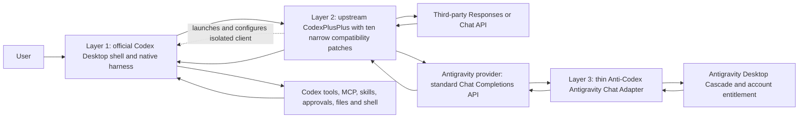

# Anti-Codex Three-Layer Architecture

- Status: project cornerstone; supersedes conflicting runtime architecture decisions
- Decision date: 2026-07-14
- Decision owner: user-approved product direction
- Upstream reference: `BigPizzaV3/CodexPlusPlus` commit `5036ff056b5c629f19356396b17d6eeb70da664c` (`v1.2.43`)

> **Source update - 2026-07-28:** Layer 2 is pinned independently to CodexPlusPlus `v1.2.43`. The same ten narrow compatibility patches replay to head `7505a6d48ca05923139b8406811f72ab3e5247c4` and tree `42e6155185508512b9eb799832d3de994e047056`; no task controller or fourth layer was added. Installed-runtime acceptance remains pending the guarded candidate/rollback gate.

> **Installed acceptance update - 2026-07-27 23:19:** The tenth Layer 2 patch is now active through the built-in updater. Source preflight passes `797/797`; installed sync-readiness, installed-overall and source/installed legacy-zero-hit pass with one copied-client root and original Codex processes unchanged. This verifies the same three layers and does not advance the separate autonomous result gate; the current task still requires a successful preferred-provider continuation and accepted final media.

> **Acceptance update - 2026-07-27:** The three layers remain unchanged. Layer 2 now carries a tenth narrow compatibility patch because some Chat SSE providers omit usage and native Codex otherwise cannot trigger its own compaction. The fallback estimates only completed-response text/tool usage, excludes embedded image Base64, and never overrides real upstream usage; it does not route, retry, plan or control tasks. The 10-patch source and independent replay share tree `efb58ba11c6f0090f1e5903b68631f5ccb973a14`; the protocol proxy suite passes 59/59 and a fresh Windows release build passed. Installed-runtime and long-task acceptance remain open.

> **Acceptance update - 2026-07-25 00:40:** The updater/runtime repair stays entirely inside Layer 1 ownership. It reuses the established `Anti-Codex Launcher`, fences acceptance/cleanup/recovery with runtime state plus exact generation, and supports byte-exact legacy rollback without adding a supervisor, provider layer or task controller. Queued/running launch requests are reused rather than opening another client. Official/active Codex remain `26.721.3996.0`; CodexPlusPlus remains `1.2.39` with nine narrow patches, and Antigravity remains the thin Chat-to-Cascade adapter. Source preflight is `763/763`, installed no-traffic checks and 11-file parity are green, and one durable visible PID `32216` remains on Gemini 3.6 Flash Low while original Codex PID `33196` stays alive. Architecture is compliant, but overall stays `97%` until current-bound Gates 5, 6 and the new autonomous Gate 8 task pass.

> **Acceptance update - 2026-07-24 22:29:** Codex `26.721.3996.0` compatibility stayed inside Layer 1 acceptance glue: primary-page selectors ignore the new avatar overlay, and the shortcut broker waits for the existing window to be painted before foreground activation. CodexPlusPlus remains the general translation/provider layer and Antigravity remains a thin Chat-to-Cascade adapter. Fresh real-model Gate 3 and isolated copied-CLI Gate 4 both pass on the same three-layer route. No fourth controller, replacement task loop or provider rewrite was added. Overall release remains `97%` until current-bound Gates 5-6 and the new autonomous Gate 8 task pass.

> **Acceptance update - 2026-07-23 16:20:** The latest Manager, taskbar-restore and exact-continuation work remains acceptance-only around the same three layers. MSAA/SendInput verifies the copied shell without launching another client; the continuation ledger audits native Codex turns but does not plan, retry or execute production work. No fourth controller was added. Architecture checks and installed UI evidence are green, but the new real task and external result acceptance are still required before 100%.

> **Acceptance override - 2026-07-23:** The three-layer architecture remains unchanged, but later 100% completion statements in this document are historical and currently withdrawn. An installed fatal page plus P1 review findings reopened the shell and integration gates. Architecture compliance is not release proof; current 100% requires the rebuilt installed client, real UI/isolation/provider-switch checks and a new autonomous long task to pass.

> **Acceptance update - 2026-07-23 12:01:** No fourth layer was introduced during closure. The 648/648 source gate confirms the fixed shell -> CodexPlusPlus -> thin Antigravity route; new Gate 5/8 evidence builders only verify that route and the real deliverable. They do not plan, retry or complete the task. Overall release remains 97% until installed and new-task evidence passes.

> **Acceptance update - 2026-07-23 13:12:** The post-adversarial source gate is 665/665, with 135/135 runtime-race checks and 37/37 Gate 8 checks. The added host-review boundary is acceptance-only: it runs after native task completion, does not send prompts, select models, plan work, call production tools on behalf of the task or create a fourth controller. Installed and real-task evidence remain pending, so architecture compliance still does not justify a 100% release claim.

> **Acceptance update - 2026-07-23 14:00:** The Gate 4/5 credential repair stays inside the fixed three layers: Codex authenticates to its local CodexPlusPlus proxy with an isolated local bearer, while CodexPlusPlus authenticates to the thin Antigravity Chat adapter with that adapter's separate generated token. The 8484 test dependency was removed; no controller or task policy was added. The source gate is 672/672, but installed and real-task evidence remain pending, so release is still 97%.

## 1. Final Product Shape

Anti-Codex has exactly three layers. A fourth task-control layer is forbidden.

The official Codex harness owns planning, tool selection, tool execution, approvals, retries, cancellation, compaction, conversation state and task completion. Neither CodexPlusPlus nor the Antigravity Provider Adapter may take over those decisions.

Layer 3 is used only when the selected provider is Antigravity. A normal third-party API provider goes directly from CodexPlusPlus to that provider and never enters the Antigravity adapter or any Anti-Codex translator.

## 2. Layer 1: Official Codex Shell

Use the official Codex Desktop package as the product shell.

Keep:

- guarded copy/update/rollback of the current official package;
- native Codex UI, harness, tool executor, MCP, skills, permissions, conversations and compaction;
- isolated Anti-Codex state so original Codex data is not modified;
- Anti-Codex application/taskbar/tray/shortcut icons and product name;
- a minimal Chinese `管理` entry and launcher-owned diagnostics.

Development-worker boundary:

- the nine project-development MCP workers (DeepSeek, MIMO Claude Coworker, MiMoCode, DevEco, OpenCode, Kilo, CodeBuddy, Agnes and Antigravity Code Worker) belong to the outer development environment and must not be synchronized into the Anti-Codex product configuration;
- the copied Codex shell may keep its own native runtime MCP such as `node_repl`, plus future user-configured product MCPs that pass the normal isolation rules;
- a verifier must fail if a development worker appears in the Anti-Codex product config, not when those workers are absent.

Forbidden:

- replacing the Codex task loop;
- modifying `app.asar` or copied application logic to decide tools or task completion;
- keeping a forked UI implementation when the same surface can come from the current official package;
- treating injected UI helpers as an agent controller.

Every official Codex update must be synchronized from the official package, then the small branding/management compatibility layer is reapplied and verified. Product logic must not be manually copied between UI builds.

### 2.1 Hard Isolation From Original Codex

The official Codex installation is a read-only source for guarded package synchronization. It is not the executable or state used by Anti-Codex.

- The Anti-Codex CodexPlusPlus build must target the Anti-Codex client copy, never the original installed Codex executable.
- Anti-Codex must use its own `CODEX_HOME`, application-data root, session database, logs, reports, ports, shortcuts and process tree.
- CodexPlusPlus state used by Anti-Codex must also be isolated from any CodexPlusPlus configuration that targets original Codex.
- Original Codex installation files, `%USERPROFILE%\.codex`, sessions, login state, running processes and shortcuts must remain unchanged.
- Every compatibility, update and release test snapshots original Codex process IDs plus relevant file/state fingerprints before and after. Any unexplained change fails the gate.
- If the upstream CodexPlusPlus provider/proxy plus the ten approved patches cannot select the copied client path and isolated state, the compatibility gate fails. Anti-Codex must not fall back to operating on original Codex.

## 3. Layer 2: CodexPlusPlus Integration

Use upstream CodexPlusPlus as a separately licensed component. Its provider management and Responses/Chat protocol implementation remain upstream behavior. Anti-Codex carries exactly ten rebaseable patches: copied-product isolation, plain-HTTP loopback cancellation, exact native-helper tool suppression, frontend-model-directed dual-relay and compaction routing, image-bearing tool-output preservation, structured `apply_patch` priority/guidance, suppression of late reasoning only after visible text has already begun, an explicit Codex tool-conversion audit patch, the bounded long-multimodal helper-body compatibility patch, and a completed-response-only missing-usage fallback that preserves real usage and excludes embedded image Base64.

The native Codex frontend is authoritative for provider and model selection. Anti-Codex must expose one stable catalog containing exact Antigravity models, a generic Antigravity slot, a generic third-party slot and namespaced third-party models. The backend may translate those identifiers to an upstream relay/model, but it must never silently replace a concrete frontend selection with a different saved or fixed model.

Both Anti-Codex relay profiles remain configured and resident for the copied client's lifetime. Selecting a model routes the next request to the matching relay without restarting the copied client, the CodexPlusPlus helper, the fixed-route owner or the current native task. A provider failure must fail on that provider; it must not spend another provider through fallback rotation.

CodexPlusPlus responsibilities:

- launch the official desktop application without patching its installed files;
- configure an official-login-plus-API or pure-API provider;
- configure model catalog, base URL and Chat Completions protocol;
- expose Anti-Codex `管理` as the user-facing entry for a third-party provider URL, API key, model and supported protocol; test, save and apply that profile only to the isolated CodexPlusPlus state;
- route ordinary third-party Responses or Chat providers directly, with no Antigravity dependency;
- route reserved Anti-Codex model slots to one of the two resident relays while preserving concrete frontend-selected Antigravity models;
- provide its already implemented provider/session/UI integration where needed;
- translate the Codex client's Responses protocol to and from the adapter's standard Chat Completions protocol.

For Antigravity, the preferred route deliberately uses CodexPlusPlus's existing Chat Completions protocol proxy. For every other supported provider, CodexPlusPlus keeps its normal direct provider route. Anti-Codex does not reimplement provider management, Responses envelopes, history conversion or streaming state machines.

When a native task created under an Antigravity model is resumed after switching to a third-party provider, the unified catalog still retains that historical model id and its Codex tool-capability metadata. Explicit third-party choices use the `anticodex/third-party/` namespace and are stripped only at the upstream boundary. Generic slots resolve to the corresponding saved model. This is model-catalog and relay continuity only: it does not add retries, task control or another protocol layer.

Official Codex may issue native compaction before the next user turn while retaining the task's historical model id. The fourth patch recognizes only Codex's canonical `request_kind: compaction` metadata and aligns that request's model to the current known Anti-Codex frontend selection from isolated state. It changes no messages, tools, history, retry policy, compaction policy or task state. Unmarked user requests, unknown selections and ordinary CodexPlusPlus routes remain unchanged. This is a model-routing correction inside the existing CodexPlusPlus boundary, not a fourth controller or a home-grown compaction implementation.

The isolation patch is limited to an explicit CodexPlusPlus state directory, independently configurable proxy/guard ports, explicit fail-closed selection of the branded executable inside the copied app directory, copied-app-path-scoped process/manager handling, fail-closed absolute copied-app selection, and refusal to modify the shared current-user logon watcher. It may not alter provider payloads, model semantics, protocol conversion, retries or task behavior.

One transport-only exception is approved: plain HTTP loopback model streams use one-shot cancel-aware connections. A real downstream Codex cancellation drops that request immediately, including while response headers are pending, while every normal response is allowed to finish and close gracefully. The transport must never enable zero-linger or reset a successful stream. This exception does not inspect or change requests, responses, models, tools, history, retries, task state or completion. HTTPS and non-loopback third-party endpoints continue through upstream CodexPlusPlus's existing reqwest path. Gate 2 proves this boundary with deterministic checks.

One helper-safety exception is approved: when the **current user message** exactly matches the official Codex title helper or task-suggestion helper contract, CodexPlusPlus omits `tools`, `tool_choice` and `parallel_tool_calls` from that background request. Detection requires the official prefix and all stable contract markers; quoted helper text inside an ordinary user task does not match. Messages, model, stream mode, output conversion, retries and the active user task are unchanged. This prevents background helpers from executing workspace tools or competing with the real task without adding a task controller. The current complete protocol-proxy regression is 54/54.

License rule:

- do not paste or merge AGPL CodexPlusPlus source into the current non-commercial codebase;
- keep the component and isolation patch in a separately licensed AGPL source/build boundary and retain upstream notices;
- record every isolation patch hunk and keep it rebaseable against the pinned upstream commit;
- if any additional provider or protocol modification beyond the ten documented patches becomes necessary, stop and record the exact missing behavior before implementation;
- do not silently reimplement CodexPlusPlus behavior after a compatibility failure.

## 4. Layer 3: Thin Antigravity Chat Adapter

This is the only product-specific protocol component Anti-Codex writes, and only the Antigravity provider uses it.

It exposes only the standard upstream interfaces consumed by CodexPlusPlus, including:

- model discovery and model metadata;
- Chat Completions create and streaming lifecycle;
- standard text, reasoning and structured `tool_calls` fields that CodexPlusPlus supports;
- stable tool-call IDs and exact tool-result continuation;
- HTTP disconnect cancellation and local timeout propagation;
- authentication, account readiness, quota, network and upstream error mapping.

Its Antigravity-specific work is limited to:

- map system/developer/user content into structured Cascade inputs;
- publish Codex tool definitions through Antigravity native custom tools/MCP;
- convert a Cascade tool request into one standard Chat Completions tool call;
- resume the same Cascade with the exact tool result supplied by Codex;
- map Cascade text, finish, cancellation and errors back to Chat Completions output;
- maintain only the bounded opaque call/session correlation needed to resume the same Cascade.
- preserve official Codex structured helper schemas; Layer 2 enforces that title and task-suggestion helpers are text-only and cannot receive user-task tools.

It must not:

- execute user tools;
- generate or rewrite shell commands, patches, files or tests;
- infer a tool call from ordinary prose;
- retry a task, invent a repair turn, or decide that work is complete;
- inspect a workspace to compensate for model behavior;
- contain task names, marker rules, expected files or business-specific recovery;
- suppress a model request based on command meaning. Protocol-level duplicate call identifiers may be rejected, but a new semantic decision belongs to Codex.
- implement Codex Responses envelopes, `previous_response_id` history reconstruction, compaction or Codex streaming state; those belong to Codex and CodexPlusPlus.

## 5. Existing Asset Disposition

### Keep

- official Codex package synchronization, rollback and fingerprint checks;
- independent Anti-Codex state and process ownership;
- icons, product naming, shortcuts and minimal management entry;
- CodexPlusPlus's ordinary third-party provider catalog, configuration and direct routes;
- Antigravity account discovery, model catalog and health checks;
- proven Antigravity Cascade transport and native MCP/custom-tool access;
- response/cascade cancellation primitives and bounded identity storage;
- host-side real-task verifiers that inspect files, commands, exit codes and process state.

### Reuse only inside the new Provider Adapter after review

- `translator/antigravity-agentapi.mjs`;
- `translator/antigravity-native-mcp-bridge.mjs`;
- `translator/antigravity-native-harness-upstream.mjs`;
- Antigravity request registry, model routing, account and error classifiers;
- pure Antigravity transport and Chat framing helpers after contract review.

### Exit the active route

- the one-megabyte mixed `translator/adaptive-server.mjs` request path;
- self-written Codex/Chat translation that CodexPlusPlus already supplies;
- internal tools, deterministic tasks, marker/file/test awareness and artifact guards;
- command and Patch synthesis/rewrite used to compensate for agent behavior;
- automatic repair turns, forced verification, completion guessing and semantic retry loops;
- release gates that accept assistant wording or stale reports as product success.

Old code may remain temporarily for rollback while the new route is proven, but it must be unreachable from the default product route and visibly marked legacy. It is deleted after the real-task gates pass.

The exact file-by-file deletion ledger is [`LEGACY_REMOVAL_MANIFEST.md`](LEGACY_REMOVAL_MANIFEST.md). It is mandatory, not advisory.

## 6. Migration Gates

The steps are sequential. A failed gate blocks the next step.

1. **Inventory gate**: this document and the implementation audit identify every kept, reused and retired active-path module.
2. **No-traffic compatibility gate**: CodexPlusPlus with only the ten documented patches launches/configures the Anti-Codex client copy with disposable isolated state against a deterministic local fake third-party Chat Completions provider. Model selection, history, one tool call/result, streaming, cancellation, terminal errors and text-only native helpers must pass without the Antigravity adapter, and original Codex files/processes/state must have zero changes. **The pinned v1.2.43 candidate must pass this proof before activation; copied-client release proof must be rerun after every upstream update.**
3. **Provider contract gate**: a small standalone Antigravity Chat Adapter passes deterministic Chat Completions contract tests without the mixed server. **Complete: 19/19 deterministic tests plus one real exact native-tool continuation.**
4. **Route switch gate**: the disposable CodexPlusPlus provider points to the adapter; diagnostics prove the mixed translator is not serving the request. **Complete: 23/23 with one real native file-tool continuation and zero old-route hits.**
5. **Component integration gate**: the visible copied client is wired to the fixed route; current official Codex UI/features, Anti-Codex branding and bounded text/tool work pass. **Historical proof exists; current-version real-traffic proof is reopened.**
6. **Bounded edge gate**: quota exhaustion, cancellation, tool failure, malformed arguments, adapter restart, client restart, same-task resume and parallel calls pass through focused tests. **Current deterministic proof passes; release still depends on fresh Gate 5 evidence.**
7. **Component completion and release gate**: old active-path code is removed, official UI/brand regressions pass, packaging/update/rollback are proven, validation tasks are backed up/cleaned, and each of the three reported product parts reaches 100% implementation completion. **Reopened until fresh current-version release evidence passes.**
8. **Final long-task acceptance gate**: formal inventory and combined migration/greenfield journeys pass result-based host verification, followed by tangible media and website maintenance tasks across third-party and Antigravity routes. **Historical proof exists, but its artifacts were deleted; a new autonomous task is required.**

## 7. Historical Implemented Status (2026-07-19; withdrawn as current release proof)

1. **Layer 1 shell/client: 100%.** The isolated copy is synchronized to official Codex `26.715.4045.0` with CLI `0.145.0-alpha.18`. Anti-Codex icons, Chinese `管理`, native task/tool behavior and original-Codex isolation remain intact. The required scheduled-task Node owner is hidden; a 120-second, eight-sample check kept one visible Anti-Codex window and the original Codex process alive.
2. **Layer 2 CodexPlusPlus: 100%.** Pinned upstream `v1.2.39` plus the six documented patches replays to tree `d8d9fd0f35e3eae44591b7a008a628b8006b6eea`. Ordinary third-party APIs still bypass Antigravity and use upstream conversion.
3. **Layer 3 Antigravity adapter: 100%.** The adapter remains a thin Chat-to-Cascade mapping. Real quota/location failures stop honestly, while provider fallback and artifact continuation remain Codex-owned.

This section recorded a historical 100% snapshot. It is not a current release claim; the architecture remains fixed while current compatibility, visible integration and long-task acceptance are revalidated.

## 8. Acceptance Rules

- Only host-observed files, byte hashes, command counts, exit codes, test results, protocol events, process state and conversation continuity count as proof.
- Model prose, final markers, local green summaries and report freshness never prove task completion by themselves.
- A command that completed successfully must not be repeatedly executed because of adapter state loss.
- Official Codex background title and task-suggestion helpers must not execute workspace tools or create competing task loops through the Antigravity route.
- A read-only turn must leave every project hash unchanged.
- A quota-exhausted model must fail promptly and must not be retried with the same exhausted model by the adapter.
- A client restart must resume through native Codex state without the adapter reconstructing the task.
- Release acceptance must cover repair of an existing project, interrupted/idempotent migration, and a new multi-module project. Every style is validated from files, hashes, command exits and hidden host checks rather than assistant wording.

## 9. Stop Rules

- If upstream CodexPlusPlus provider/proxy behavior cannot consume the standard local Chat Completions provider after isolation, stop after the compatibility proof and report the exact unsupported contract. Do not start another home-grown general translator.
- If Antigravity cannot produce one required structured Chat behavior, isolate only that mapping in the adapter and report it. Do not move task control upward or duplicate the CodexPlusPlus Responses translator.
- Any proposed change that adds task semantics outside Codex requires explicit user approval and a revision to this cornerstone document.
