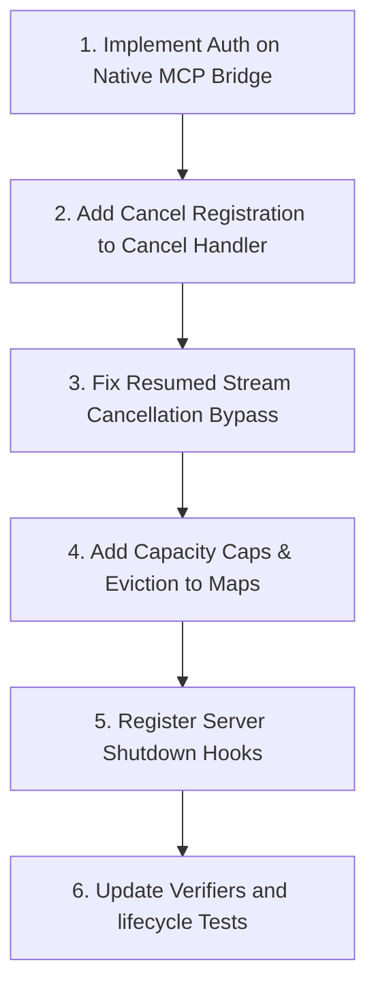

# Stage C Cancellation and Native Response-Session Lifecycle Audit

## Executive Summary
This audit inspects the current Stage C cancellation and native response-session lifecycle behaviors in the Anti-Codex gateway (specifically within the [translator](file:///G:/Trae-Project/Anti-Codex/deepcodex/translator) module) following the recent structured-path changes. The analysis is evidence-based and references the source files directly.

Several concrete product defects have been identified, particularly a bypass of Cascade cancellation during streaming turn resumption and lack of local authorization on the native MCP bridge port. These present risks of resource leaks, duplicate execution on the Desktop Language Server, and potential local security holes.

---

## Priority Risk Analysis

### Risk 1: Bypassed Cascade Cancellation on Resumed Stream Resumption
* **File/Function References**:
  - [`streamAntigravityUpstream` in translator/antigravity-upstream.mjs (L968-L974)](file:///G:/Trae-Project/Anti-Codex/deepcodex/translator/antigravity-upstream.mjs#L968-L974)
  - [`resumeAntigravityNativeTurnStreamed` in translator/antigravity-agentapi.mjs (L248-L387)](file:///G:/Trae-Project/Anti-Codex/deepcodex/translator/antigravity-agentapi.mjs#L248-L387)
* **Risk Detail**:
  When the gateway resumes a turn (continuation), `streamAntigravityUpstream` invokes `resumeTurnStreamed` with `cancelOnError: false` (to prevent teardown on transient retry errors).
  If the user cancels the request or a timeout occurs, an `AbortError` is thrown. However:
  1. In `resumeAntigravityNativeTurnStreamed`, the exception is caught, but because `options.cancelOnError` is `false`, it does not trigger `cancelCascadeBestEffort`.
  2. The abort exception bubbles up to `streamAntigravityUpstream`. In the `catch (error)` block there, if `eventEmitted` is `true` (which is almost always true for resumed sessions as they yield tool/text events quickly), the catch block immediately rethrows `error` without calling `cancelAntigravityCascade`.
* **Impact**: The active cascade invocation on the Desktop Language Server is **never cancelled**. It continues running to completion in the background, consuming CPU, memory, and executing tools on the host.

### Risk 2: Gateway Restart Orphans Downstream Cascades (Resource Leak)
* **File/Function References**:
  - `NATIVE_RESPONSE_SESSIONS` Map and `NATIVE_CONTINUATIONS` Map in [`translator/antigravity-upstream.mjs`](file:///G:/Trae-Project/Anti-Codex/deepcodex/translator/antigravity-upstream.mjs)
* **Risk Detail**:
  The native sessions and continuations tracking structures are kept entirely in-memory. If the gateway server restarts (due to runtime updates, crash recovery, or system reboot), all active cascade connections, session details, and bridge objects are destroyed.
  Crucially, there are no shutdown hooks in the server/app lifecycle to notify the Desktop Language Server to cancel all running cascades registered in `NATIVE_RESPONSE_SESSIONS`.
* **Impact**: All currently executing cascades on the local machine leak and run in the background. When the client reconnects, it fails to match a session and starts a new cascade, resulting in duplicate background executions.

### Risk 3: Unbounded Memory Growth in Response Session Storage
* **File/Function References**:
  - `NATIVE_RESPONSE_SESSIONS` Map in [`translator/antigravity-upstream.mjs` (L51, L1019)](file:///G:/Trae-Project/Anti-Codex/deepcodex/translator/antigravity-upstream.mjs#L51)
* **Risk Detail**:
  `NATIVE_RESPONSE_SESSIONS` is instantiated as a raw Javascript `Map` object. There are no size-based limits or LRU eviction strategies implemented.
  It relies solely on a 30-minute `setTimeout` for TTL eviction. If a client opens many connections or does not resume them under heavy load, the map will grow linearly with the volume of completed response streams.
* **Impact**: Potential process memory bloating and eventual Out-Of-Memory (OOM) crashes in environments with high traffic or long-running gateway uptimes.

### Risk 4: Delayed Background Requests Bypass Cancellation Protection
* **File/Function References**:
  - [`resetCancelledPreviousResponseFailure` in translator/adaptive-server.mjs (L13498)](file:///G:/Trae-Project/Anti-Codex/deepcodex/translator/adaptive-server.mjs#L13498)
  - `/v1/responses/:id/cancel` handler in [`translator/adaptive-server.mjs` (L16027-L16034)](file:///G:/Trae-Project/Anti-Codex/deepcodex/translator/adaptive-server.mjs#L16027-L16034)
* **Risk Detail**:
  When a user cancels a single response ID, the gateway calls `ACTIVE_ANTIGRAVITY_REQUESTS.cancel(id)` and releases the session lock. It does **not** insert the cancelled ID into `RESET_CANCELLED_RESPONSE_IDS` (which is only updated during global session resets).
  If a delayed background request or client retry arrives later referencing the cancelled `previous_response_id`, it will not be blocked by `resetCancelledPreviousResponseFailure`.
  Because the session has already been removed from `NATIVE_RESPONSE_SESSIONS`, the gateway will treat it as a brand-new turn request and spin up a duplicate, fresh Cascade.
* **Impact**: Out-of-order execution, duplicated work, and state collision within the same conversation path.

### Risk 5: Insecure Native MCP Bridge Local Server (Missing Authentication)
* **File/Function References**:
  - [`createAntigravityNativeMcpBridge` in translator/antigravity-native-mcp-bridge.mjs (L12-L68)](file:///G:/Trae-Project/Anti-Codex/deepcodex/translator/antigravity-native-mcp-bridge.mjs#L12-L68)
* **Risk Detail**:
  The native MCP bridge spins up an HTTP server on `127.0.0.1` and a random free port to receive tool list and execution requests from the upstream Antigravity process.
  However, the server accepts and executes all requests without validating any security headers, signatures, or access tokens.
* **Impact**: Any local application running on the host system can scan loopback ports, discover the bridge, and execute arbitrary Codex-owned tools via the `/tools/call` endpoint, bypassing authorization.

---

## Product Defects vs. Verifier Defects

| Defect Type | Code Area | Description |
| :--- | :--- | :--- |
| **Product Defect** | `antigravity-upstream.mjs` | Bypassed cascade cancellation on resumed session abort. |
| **Product Defect** | `adaptive-server.mjs` | Lack of cancellation registration in `RESET_CANCELLED_RESPONSE_IDS` on individual response cancellation. |
| **Product Defect** | `antigravity-upstream.mjs` | Unbounded size of `NATIVE_RESPONSE_SESSIONS` and `NATIVE_CONTINUATIONS` Maps. |
| **Product Defect** | `antigravity-native-mcp-bridge.mjs` | Local MCP bridge HTTP server has no request authorization. |
| **Verifier Defect** | `test-anticodex-cancellation.ps1` | The verifier only asserts that the gateway's SSE stream emits `response.cancelled`. It does not verify that the Language Server received a `CancelCascadeInvocation` request. |
| **Verifier Defect** | `antigravity-response-lifecycle.test.mjs` | Life-cycle tests do not verify cancellation behavior when a session is resumed or when `eventEmitted` is `true`. |

---

## Technical Audit Coverage & Evidence

### 1. User Cancel / Timeout Stopping Active Cascade and Queued Work
* **Queued Work**: In [`createAntigravityRequestQueue`](file:///G:/Trae-Project/Anti-Codex/deepcodex/translator/antigravity-request-queue.mjs), when a queued entry's abort signal fires, the listener immediately removes it from the queue and rejects it:
  ```javascript
  const onAbort = () => {
    if (!entry.controller.signal.aborted) entry.controller.abort(abortReason(signal));
    const index = queue.indexOf(entry);
    if (index === -1) return;
    queue.splice(index, 1);
    reject(abortReason(signal));
  };
  ```
  This correctly prevents queued work from starting.
* **Active Cascade**: In `runAntigravityNativeTurnStreamed`, aborting the signal immediately fires:
  ```javascript
  const onAbort = () => {
    if (!idleController.signal.aborted) idleController.abort(signal?.reason);
    cancelAndClean();
  };
  ```
  This terminates the cascade on the Language Server. However, as noted in **Risk 1**, this cancellation is **bypassed** for resumed continuation streams when `eventEmitted` is `true`.

### 2. No-New-Call Observation After Cancel
* A lookup on `NATIVE_RESPONSE_SESSIONS` for a cancelled response will fail because the session is removed from the map upon being resumed, and is not re-registered if aborted mid-flight.
* However, because the cancelled ID is not recorded in the `RESET_CANCELLED_RESPONSE_IDS` map, the gateway does not block a delayed retry/continuation request. It will proceed to launch a new, duplicate cascade invocation instead of returning a `409` session reset error.

### 3. NATIVE_RESPONSE_SESSIONS Capacity, TTL, and Eviction
* **TTL**: Both `NATIVE_RESPONSE_SESSIONS` and `NATIVE_CONTINUATIONS` implement TTL timeouts via `setTimeout` which cleans up the maps:
  - `NATIVE_RESPONSE_SESSION_TTL_MS`: 30 minutes.
  - `NATIVE_CONTINUATION_TTL_MS`: 10 minutes.
* **Capacity / Eviction**: There is no cap on the number of concurrent maps stored in memory. It is vulnerable to denial-of-service memory pressure.

### 4. Gateway Restart Behavior
* No persistent state file is written for active sessions. Upon gateway exit or crash, all connections and session maps are cleared from memory. No cleanup requests (`CancelCascadeInvocation`) are sent to the Language Server, resulting in orphaned background execution loops.

### 5. Delayed Desktop Background Requests
* If a background request is delayed (arriving after a response was cancelled), it is not rejected because individual cancellations do not update the `RESET_CANCELLED_RESPONSE_IDS` registry. The system will start a new cascade for it.

### 6. Preservation of Codex-Owned Task Control
* Codex-owned tools are strictly routed back to the gateway using the Local MCP Bridge. The gateway acts as the exclusive executor, keeping execution control in the local Anti-Codex wrapper.
* Security Gap: The loopback bridge is completely open to local processes on the system, which could run tools using the gateway's credentials.

---

## Propose Implementation & Test Sequence

To address these vulnerabilities with minimal code footprint and no disruption to normal traffic, the following sequence is recommended:



### Phase 1: Gateway Hardening (Smallest Changes)
1. **Bridge Security**: Generate a random cryptographically secure token on bridge initialization and check it on incoming requests to the bridge.
2. **Cancellation Persistence**: In `/v1/responses/:id/cancel`, call `rememberResetCancelledResponseIds([id], "response_cancel")` to populate `RESET_CANCELLED_RESPONSE_IDS`.
3. **Resumed Cancellation Fix**:
   - Modify `streamAntigravityUpstream` `catch` block to invoke `cancelAntigravityCascade` if the thrown error is an `AbortError`.
   - Update `resumeAntigravityNativeTurnStreamed` to attach an abort listener to `signal` (mirroring `runAntigravityNativeTurnStreamed`) to cancel the cascade immediately upon signal abort.
4. **Capacity Constraints**: Introduce a max size (e.g. 50 entries) for `NATIVE_RESPONSE_SESSIONS`. If exceeded, evict the oldest entry and invoke its cleanup and cascade cancellation.
5. **Shutdown Cleanup**: Add a `process.on('SIGTERM' / 'SIGINT')` listener to the server entrypoint to iterate through `NATIVE_RESPONSE_SESSIONS` and clean up/cancel all active cascades.

### Phase 2: Test & Verifier Updates
1. **Mock Verification in Unit Tests**: Update `antigravity-response-lifecycle.test.mjs` to add a test case where a resumed stream is aborted, asserting that `CancelCascadeInvocation` is called.
2. **Real Traffic Verifier Hardening**: Update `scripts/test-anticodex-cancellation.ps1` to query the Language Server's active cascade count or mock its invocation to verify cascade teardown.
