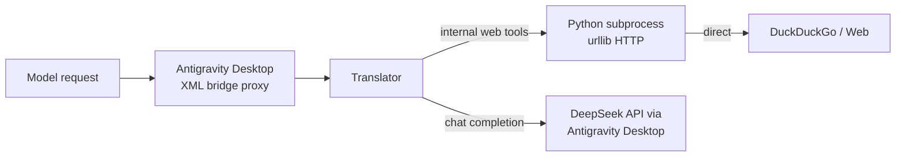

# Antigravity Internal Web Tools Audit — 2026-06-14

> **Scope:** Gap analysis for safely enabling translator-provided `web_search` / `web_fetch` in
> Antigravity mode (prompt-mediated XML bridge via Antigravity Desktop).
>
> **Target:** Align Anti-Codex with standard Codex web-search/fetch capability for users who
> choose Antigravity Desktop as their upstream.
>
> **Method:** Read-only source review of `translator/adaptive-server.mjs`, `compat-rules.mjs`,
> `tools/registry.mjs`, Python backends, and related tests. No code was changed.

---

## Table of Contents

1. [Current state: why internal web tools are disabled](#1-current-state-why-internal-web-tools-are-disabled)
2. [How the disable propagates](#2-how-the-disable-propagates)
3. [What would need to change to enable](#3-what-would-need-to-change-to-enable)
4. [Risks and mitigations](#4-risks-and-mitigations)
5. [Antigravity proxy bypass (key concern)](#5-antigravity-proxy-bypass-key-concern)
6. [Recommended conditions for safe enablement](#6-recommended-conditions-for-safe-enablement)
7. [Acceptance tests](#7-acceptance-tests)
8. [Related prior audit](#8-related-prior-audit)

---

## 1. Current state: why internal web tools are disabled

### Root cause

In `translator/adaptive-server.mjs`, the function `antigravityProfileFromCatalog()` (line 367–387)
constructs a hardcoded capability profile for Antigravity mode:

```javascript
// line 379-384
capabilities: {
    vision: catalogModels.some((model) => model?.input_modalities?.includes("image")),
    hostedTools: false,
    internalWebTools: false,          // ← explicitly disabled
    nativeStreaming: false,
},
```

This profile is applied unconditionally during startup on line 3150–3155:

```javascript
if (isAntigravityUpstreamMode(UPSTREAM_MODE)) {
    PROFILE = antigravityProfileFromCatalog(loadAntigravityCatalog());
    // ...
}
```

The same hardcoded `internalWebTools: false` is used whenever the catalog is hot-refreshed
(line 389–405, `buildAntigravityModelRefresh` → `antigravityProfileFromCatalog`).

### Why was it disabled?

There is no inline comment explaining the rationale. Based on the codebase context, the
likely reasons (in order of plausibility):

| Reason | Evidence |
|--------|----------|
| **Antigravity Desktop proxy bypass** — the internal Python tools use raw urllib, which does not route through the Antigravity Desktop proxy. This defeats traffic auditing/control. | No proxy environment variable handling in `web_search_urllib.py` or `web_fetch.py`. |
| **Never tested in Antigravity mode** — the non-Antigravity path (probe-based) got this feature first; enabling it in Antigravity mode was deferred. | `core-completion-audit.md` line 168 noted the gap. |
| **Dependency on Python + stdlib urllib** — the tools run as subprocess Python scripts that must work in the Antigravity Desktop environment. | `registry.mjs` line 20–52 uses `execFile` to run `.py` scripts. |
| **DuckDuckGo scraper reliability** — the search backend is a DDG Lite/HTML scraper with no API key, which can break. | `web_search_urllib.py` imports `ddg_urllib_search` with multiple fallback attempts. |

---

## 2. How the disable propagates

The single `internalWebTools: false` in the profile triggers three guard chains:

### 2a. System prompt — model is told web tools are unavailable

In `buildSystemBlock()` (line 482):

```javascript
const hasInternalWebTools = !caps.hostedTools && caps.internalWebTools !== false;
```

Because `internalWebTools === false`, `hasInternalWebTools` is `false`. This causes the
system prompt to emit:

> "No translator-provided web tools are configured. If a request needs web access,
> pause the workflow and ask the user to manually take over."

The model is explicitly instructed not to use web tools.

### 2b. Tool injection — registry skips web tools

In `translator/tools/registry.mjs`, the `roleEnabled()` check (line 65–69):

```javascript
function roleEnabled(profile, role) {
    const caps = profile?.capabilities || {};
    const strategy = profile?.toolStrategy || {};
    if (role === "web_search" || role === "web_fetch") {
        return caps.internalWebTools !== false && (!route || String(route).startsWith("local."));
    }
    return true;
}
```

With `internalWebTools: false`, this returns `false` for both `web_search` and `web_fetch`.

This affects:
- `toolsToInject(profile)` — returns empty array, so no web tools are injected into the Chat
  Completions tool list
- `getToolChoiceForRole(role, profile)` — returns `null`, no tool definition available

### 2c. Translation plan — hosted tools are dropped, internal tools not injected

In `compat-rules.mjs`, the `buildChatToolsWithRouting()` function (line 224–368):

- Hosted tools like `web_search` (from Codex request) are dropped because they are in `HOSTED_ONLY`
- Internal tools are only appended if `injectInternal` is true (which is true) AND
  `toolsToInject(PROFILE)` returns non-empty — which it doesn't

### 2d. Diagnostics endpoint reports the state

In `diagnosticsPayload()` (line 296–297):

```javascript
capabilities: {
    hostedTools: Boolean(PROFILE?.capabilities?.hostedTools),
    internalWebTools: Boolean(PROFILE?.capabilities?.internalWebTools),  // → false
    // ...
}
```

This is visible to users at `/anticodex/diagnostics`.

---

## 3. What would need to change to enable

### Minimal code change

A single value change in `antigravityProfileFromCatalog()` (line 382):

```diff
- internalWebTools: false,
+ internalWebTools: true,
```

Or, to keep backward compatibility with an explicit opt-in:

```diff
- internalWebTools: false,
+ internalWebTools: process.env.ANTIGRAVITY_INTERNAL_WEB_TOOLS === "1",
```

This single change propagates correctly through the entire chain:

1. `buildSystemBlock()` → `hasInternalWebTools` becomes `true` → system prompt instructs the
   model to use `web_search` and `web_fetch`
2. `toolsToInject()` → returns `[web_search, web_fetch]` definitions
3. `buildChatToolsWithRouting()` → appends internal tools to the Chat Completions tool list
4. `callUpstreamWithInternalTools()` → intercepts and executes internal tool calls locally

### What does NOT need to change

| Component | Why unchanged |
|-----------|---------------|
| `tools/registry.mjs` | Already correctly implements `internalWebTools` gate; no changes needed |
| `compat-rules.mjs` | Already correctly drops hosted tools and injects internal tools when provided |
| `buildSystemBlock()` | Already shows/hides web tool instructions based on `internalWebTools` |
| `callUpstreamWithInternalTools()` | Already handles internal tool execution independently of upstream mode; no changes needed |
| `web_search_urllib.py` / `web_fetch.py` | Pure Python stdlib; no Antigravity-specific changes needed |
| `responsiveChatBody()` | Already passes `injectInternalTools` through the tool injection path |

### Code paths that would activate after enablement

| Line | Function | Behavior after change |
|------|----------|----------------------|
| 482 | `buildSystemBlock()` | Emits web tool usage instructions |
| 501–502 | `buildSystemBlock()` | `getToolChoiceForRole("web_search", PROFILE)` returns the urllib definition |
| 1122 | `responsesToChatBody()` | `injectInternalTools ? toolsToInject(PROFILE) : []` returns `[web_search_def, web_fetch_def]` |
| 2460–2508 | `callUpstreamWithInternalTools()` | Intercepts model's `web_search`/`web_fetch` calls, executes locally, feeds results back |
| 2559 | `canUseNativeStreaming()` | Returns `false` when internal tools are present (already correct — native streaming is disabled when tools need execution) |

---

## 4. Risks and mitigations

### Risk 1: Outbound network from subprocess bypasses Antigravity Desktop

**Severity: Medium**

The Python scripts make direct HTTP requests via `urllib.request.urlopen()`. They do not
honour the Antigravity Desktop proxy configuration (typically `http://127.0.0.1:10086`).

**Mitigation options:**

1. **Accept for local-only deployments** — the translator runs on the user's machine, the
   HTTP requests go to public DuckDuckGo/search endpoints. This is the same risk as in
   non-Antigravity mode.

2. **Add env-var proxy support** — teach the Python scripts to read `HTTP_PROXY`/`HTTPS_PROXY`:

   ```python
   import os
   proxy = os.environ.get("HTTPS_PROXY") or os.environ.get("HTTP_PROXY")
   if proxy:
       urllib.request.install_opener(urllib.request.build_opener(
           urllib.request.ProxyHandler({"http": proxy, "https": proxy})
       ))
   ```

3. **Route through Antigravity Desktop proxy endpoint** — use the Antigravity Desktop HTTP
   endpoint (`http://127.0.0.1:10086/proxy?url=...`) if available. This preserves traffic
   visibility for the Antigravity proxy.

### Risk 2: Python runtime missing or incompatible

**Severity: Low**

The `execPython()` helper in `registry.mjs` (line 20–52) already handles fallback across
multiple Python candidates (`python3`, `python`, `py`). If all fail, the tool returns
a structured `{ok: false, error: "python runtime unavailable"}` error.

### Risk 3: DuckDuckGo rate limiting or scraping breakage

**Severity: Low-Medium**

`ddg_urllib_search.py` uses DuckDuckGo Lite/HTML endpoints without an API key. Rate
limiting or HTML changes can break search.

The `executeInternalTool()` function (line 154–177) already handles this gracefully — if
the first candidate returns `{ok: false}`, it proceeds to the next candidate (currently only
one candidate per role). The model receives the structured error and can handle it.

### Risk 4: Increased tool-loop latency in prompt-mediated mode

**Severity: Low**

Antigravity mode uses prompt-mediated (XML bridge) tool calls. Each internal tool execution
requires:
1. Model generates internal tool call → Chat API → response
2. Translator intercepts, executes Python script (15–25s timeout)
3. Result injected back → another Chat API call
4. Model continues

This is the same latency profile as non-Antigravity mode. The existing `MAX_TOOL_LOOPS=12`
limit applies. No special Antigravity concern.

### Risk 5: Internal tool fallback text contains non-Chinese fallback

**Severity: Low**

In `finalizeWithoutTools()` (line 2426–2458), fallback messages include Chinese text.
The final "no tool" fallback from `executeInternalTool()` (line 172–176) uses English.
This is a minor consistency issue, not a correctness blocker.

---

## 5. Antigravity proxy bypass (key concern)

### How it works today



The internal tools' HTTP requests go **directly** to the internet, bypassing the
Antigravity Desktop proxy entirely. This matters because:

- **Traffic visibility:** The Antigravity Desktop proxy cannot log or audit outbound
  search/fetch traffic
- **Corporate proxy:** If the user is behind a corporate HTTP proxy, `urllib.request.urlopen`
  may or may not use it depending on the Python build/system configuration (stdlib
  `urllib` respects `HTTP_PROXY`/`HTTPS_PROXY` env vars on most platforms, but
  the scripts do not explicitly configure a proxy)
- **Security policy:** Some Antigravity deployments may intend all outbound traffic to
  go through the Antigravity Desktop proxy

### Recommended approach

For the initial enablement, add an env-var conditional that defaults to **off**:

```
ANTIGRAVITY_INTERNAL_WEB_TOOLS=1  → enables internal web tools
                                  → (also honour HTTP_PROXY/HTTPS_PROXY)
```

This gives users explicit control and documents the proxy-bypass trade-off. A future
improvement could route through the Antigravity Desktop proxy endpoint.

---

## 6. Recommended conditions for safe enablement

### Minimum safe change

```diff
// in antigravityProfileFromCatalog(), line 382
- internalWebTools: false,
+ internalWebTools: process.env.ANTIGRAVITY_INTERNAL_WEB_TOOLS === "1",
```

### Starter (more conservative)

Also log a warning at startup to make the proxy bypass visible:

```javascript
if (process.env.ANTIGRAVITY_INTERNAL_WEB_TOOLS === "1") {
    console.error("[adaptive] WARNING: Antigravity internal web tools enabled. "
        + "Outbound HTTP requests bypass the Antigravity Desktop proxy.");
}
```

### Recommended (with proxy support)

Teach the Python scripts to honour `HTTP_PROXY`/`HTTPS_PROXY` before enabling by default.
Given that `urllib.request.urlopen` already reads these env vars on many platforms, the
minimum intervention is to **document** that `HTTP_PROXY`/`HTTPS_PROXY` must be set in
the translator environment if proxy routing is required.

### No-change-needed items

- `tools/registry.mjs` — the `internalWebTools` gating already works correctly
- `compat-rules.mjs` — hosted-tool dropping and internal-tool injection logic is correct
- `buildSystemBlock()` — dynamically adapts to `internalWebTools` flag
- `callUpstreamWithInternalTools()` — works identically in both Antigravity and non-Antigravity modes

---

## 7. Acceptance tests

### 7a. Unit tests — registry

| Test | What to verify | Current coverage |
|------|----------------|------------------|
| `toolsToInject` returns web tools for antigravity profile with `internalWebTools: true` | `internal-tools.test.mjs` | Covers `noHostedProfile` (implicit `internalWebTools: true`) and `disabledInternalWebProfile` but **not** an explicit antigravity profile |
| `getToolChoiceForRole` returns urllib for antigravity profile | same | Same gap |

**New test suggestion** (`internal-tools.test.mjs`):

```javascript
const antigravityProfile = {
    provider: "antigravity",
    capabilities: { hostedTools: false, internalWebTools: true, nativeStreaming: false },
};

test("toolsToInject returns web tools for antigravity mode when internalWebTools=true", () => {
    const names = toolsToInject(antigravityProfile).map(t => t.function.name).sort();
    assert.deepEqual(names, ["web_fetch", "web_search"]);
});

test("getToolChoiceForRole returns urllib for antigravity mode", () => {
    assert.equal(getToolChoiceForRole("web_search", antigravityProfile), INTERNAL_TOOLS.web_search_urllib);
});
```

### 7b. Unit tests — system prompt

| Test | What to verify | Current coverage |
|------|----------------|------------------|
| System block includes web tool instructions when profile has `internalWebTools: true` | `buildSystemBlock()` with antigravity profile | `adaptive-pseudo-tools.test.mjs` line 873 tests the default (probe-based) profile only |

**New test suggestion** (`adaptive-pseudo-tools.test.mjs`):

```javascript
import { buildSystemBlock, antigravityProfileFromCatalog } from "../adaptive-server.mjs";

test("system block includes web tool instructions for antigravity mode when enabled", () => {
    // Simulate an antigravity profile with internalWebTools enabled
    const catalog = { models: [{ slug: "gemini-pro-agent" }] };
    // The test needs access to the antigravityProfileFromCatalog function — it's exported.
    // However, to test the buildSystemBlock output, set PROFILE or use a DI approach.
    // This may require a helper that accepts an explicit profile.
});
```

Note: `buildSystemBlock()` currently reads from the module-level `PROFILE` variable.
To test this properly without mocking the module global, consider adding a `profile`
parameter to `buildSystemBlock()` or exporting a test helper.

### 7c. Integration tests — tool loop

| Test | What to verify | Current coverage |
|------|----------------|------------------|
| Internal web tools execute and return results in Antigravity mode | `callUpstreamWithInternalTools` with antigravity profile | No dedicated antigravity + internal tools integration test |

**New test suggestion** (use `callUpstreamWithInternalTools` with a mock upstream and
mock internal tool execution):

```javascript
test("antigravity mode internal web tools execute via callUpstreamWithInternalTools", async () => {
    // Mock fetch to respond with a tool_call for web_search
    // Mock __DEEPCODEX_TEST_EXEC_INTERNAL_TOOL__ to return valid results
    // Verify the tool loop resolves with final answer
});
```

### 7d. Diagnostics verification

| Test | What to verify | Current coverage |
|------|----------------|------------------|
| Diagnostics reports `internalWebTools: true` when enabled | `/anticodex/diagnostics` payload | No dedicated test for antigravity diagnostics |

### 7e. Manual / integration test scenarios (for QA)

1. **Basic search flow:** In Antigravity mode, prompt "搜索一下 DeepSeek V4 的最新新闻"
   → model should call `web_search` → internal tool executes → results return → model
   answers.

2. **Proxy bypass visibility:** Enable `ANTIGRAVITY_INTERNAL_WEB_TOOLS=1`, start translator,
   observe startup warning about proxy bypass.

3. **Proxy route:** Set `HTTP_PROXY=http://127.0.0.1:10086`, run search, verify outbound
   traffic goes through the proxy (via proxy logs or packet capture).

4. **Python unavailable:** Remove `python` from PATH, verify tool returns
   `{ok: false, error: "python runtime unavailable"}` and the model handles it gracefully.

5. **Tool loop limits:** Make the model repeatedly call `web_search`, verify the loop
   terminates at `MAX_TOOL_LOOPS` (or after repeated identical calls) with a proper
   fallback message.

6. **Native streaming remains disabled:** Verify `canUseNativeStreaming()` returns
   `false` when internal web tools are present (regardless of upstream mode).

7. **Compact mode blocks tools:** Verify `prepareCompactChatBody` strips internal web
   tools when in Antigravity mode with internal web tools enabled (compact mode already
   strips all tools — this should pass unchanged).

### 7f. Test order / dependency

1. Unit tests (registry + system prompt) — fast, no external dependencies
2. Integration test (tool loop) — requires mock upstream
3. Manual scenarios — requires real Antigravity Desktop connection

---

## 8. Related prior audit

The `core-completion-audit.md` (2026-06-13) identified this gap at lines 158–172:

> "Previous DeepSeek/OpenAI path had internal web tools (web_search, web_fetch), but
> Antigravity mode disables even those."
>
> **Recommended next step:** "Re-enable Antigravity Desktop's `searchWeb` tool or implement
> a translator-level web fetch that calls a search API (like the `internalTools` path in
> non-antigravity mode)."

This audit provides the detailed implementation analysis for that recommendation.

---

## Summary

| Item | Assessment |
|------|------------|
| **Root cause** | Hardcoded `internalWebTools: false` in `antigravityProfileFromCatalog()` at line 382 of `adaptive-server.mjs` |
| **Can safely enable?** | Yes, with opt-in via env var `ANTIGRAVITY_INTERNAL_WEB_TOOLS=1` |
| **Primary risk** | Outbound HTTP bypasses Antigravity Desktop proxy — traffic not visible/controllable |
| **Code change needed** | Change line 382 to `internalWebTools: process.env.ANTIGRAVITY_INTERNAL_WEB_TOOLS === "1"` (or similar conditional), plus a startup warning log |
| **Files to change** | `translator/adaptive-server.mjs` only |
| **Files verified unchanged** | `tools/registry.mjs` ✓, `compat-rules.mjs` ✓, `web_search_urllib.py` ✓, `web_fetch.py` ✓, `ddg_urllib_search.py` ✓ |
| **Tests to add** | 2 unit tests in `internal-tools.test.mjs`, 1 integration test, 1 system-prompt test (may need refactoring of `buildSystemBlock()`) |
| **Acceptance criteria** | All 7 scenarios in section 7e pass |
